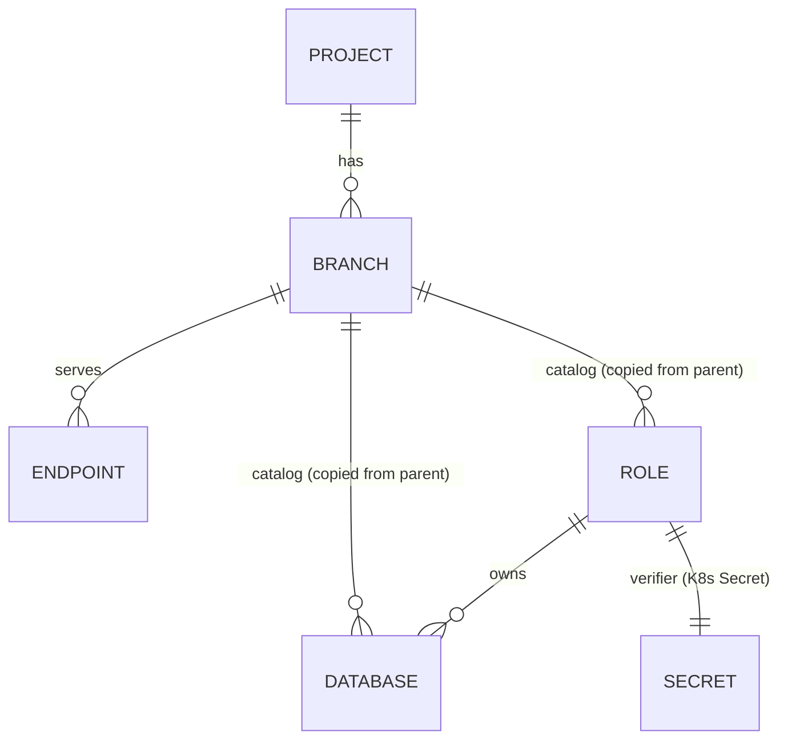
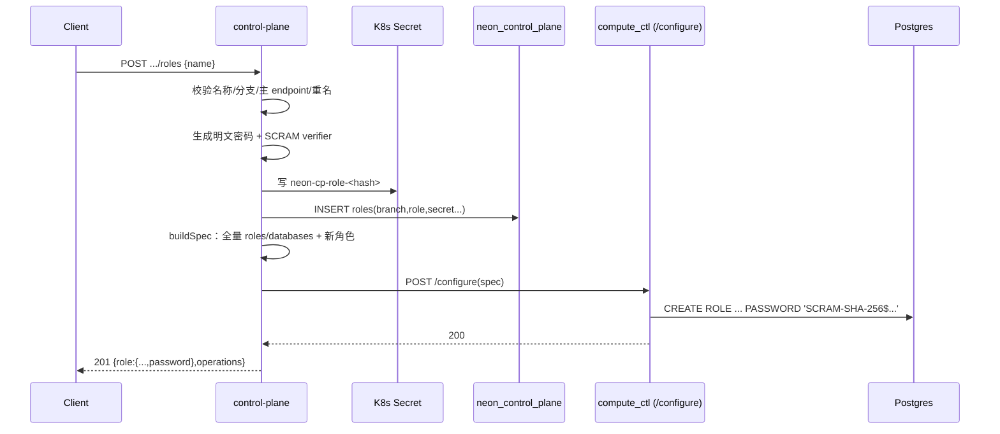

# control-plane API 补齐设计（Step 1 + Step 2）

> **文档状态**：设计方案，尚未实施。本文只定义契约、数据模型、写入时序与改造点，不包含代码改动。
>
> **范围**：
>
> - **Step 1（只读 API，无迁移）**：`GET /regions`、单分支查询、单 endpoint 查询、分支 endpoint 列表。
> - **Step 2（目录 API + 迁移 0003）**：branch 级 roles / databases 的 CRUD、`reset_password`，以及对应的 ComputeSpec / Secret 改造。
>
> **不在本文范围**：endpoint 生命周期（start/suspend/restart）、operations 落库、PATCH project/branch/endpoint、PITR / project recover / snapshots（属于 Step 3/4）。
>
> **依据**：
>
> - `docs/api.md`：官方端点索引（仅路径索引，不含 schema）。
> - Neon OpenAPI v2（`https://neon.com/api_spec/release/v2.json`）：请求/响应结构。
> - `docs/user-password-storage.md`：角色与密码的权威存储位置、verifier 流转。
> - `charts/neon-control-plane/src/`：当前实现（`apiHandler`、`prepareEndpointForBranch`、`buildSpecFromEndpoint`、`credentials.go`、`store_postgres.go`）。
> - `/home/postgres/works/opensource/neon`：`compute_api` / `compute_tools` 的 spec 应用逻辑。

---

## 0. 决策摘要

| 编号 | 决策 | 理由 |
| --- | --- | --- |
| D1 | 角色与数据库属于 **branch**，不属于 endpoint；endpoint 只是访问入口 | 与 Neon 模型一致；`connection_uri` 的 role/database 参数本来就是分支维度 |
| D2 | 新增 `roles` / `databases` 两张表，作为控制面的 **desired catalog**；迁移 0003，additive | 现 `endpoint_credentials` 是 endpoint 级、只存一个 role/db，无法表达多角色/多库 |
| D3 | 密码验证器（SCRAM verifier）按 **(branch, role)** 存 K8s Secret，库中只存 Secret 名称/键名 | 沿用 `docs/user-password-storage.md` 的结论：权威在 `pg_authid`，控制面存副本供下发；明文不落库 |
| D4 | 角色/数据库变更统一走 **更新 ComputeSpec + `POST compute_ctl /configure`**，不直连 SQL | 控制面没有明文管理员密码；与 Neon 的写入路径一致（`spec_apply.rs` 的 `CreateAndAlterRoles` / `CreateAndAlterDatabases`） |
| D5 | 删除/重命名使用 ComputeSpec 新增的 `delta_operations`（`delete_role` / `delete_db` / `rename_db`） | compute_ctl 已支持（`libs/compute_api/src/spec.rs:531-542`、`compute_tools/src/spec_apply.rs`） |
| D6 | 创建分支时 **同步复制** 父分支的 roles/databases 行，并为新分支生成独立的角色 Secret | 分支 catalog 是父时间线在该时刻的快照；密码后续可在分支间独立轮换，不能共享 Secret |
| D7 | 明文密码只在 **创建角色** 与 **reset_password** 时返回一次；不实现 `reveal_password`（返回 501） | 控制面只存 verifier，无法还原明文；与现有项目创建行为一致 |
| D8 | 目录变更要求目标分支存在 **running 的 read_write endpoint**；否则 409 | `read_only` 副本不应用 catalog；没有主节点时 `configure` 无法落地 |
| D9 | Step 1 不引入任何数据库迁移；`GET /regions` 返回配置驱动的单 region | 部署为单 region，CLI/SDK 只需要一个合法响应 |
| D10 | 每个分支的目录写操作串行化（进程内 per-branch mutex） | 单副本控制面；避免并发 create/delete 造成 spec 顺序错乱 |
| D11 | `no_login` / 任意 role options **本阶段不支持**（请求返回 400） | `compute_ctl` 的 `to_pg_options` 无条件追加 `LOGIN`（`pg_helpers.rs:146-167`），`NOLOGIN` 无法可靠表达，需上游改造后再支持 |
| D12 | 目录写失败语义按“可幂等方向”排序：**创建**先写库/Secret 再 configure、失败回滚；**删除**先 configure（`IF EXISTS` 幂等）再删库行；**重置密码**先备份旧 verifier、失败恢复 | 与现有 Saga 原则一致（`src/orchestration.go`），避免“库里有记录但 PG 里没有”的不可重试状态 |

---

## 1. 现状与差距

### 1.1 已实现的 API

| 资源 | 已实现 |
| --- | --- |
| Projects | `POST /projects`、`GET /projects`、`GET /projects/{id}`、`DELETE /projects/{id}`、`GET /projects/{id}/connection_uri` |
| Branches | `POST` / `GET` / `DELETE /projects/{id}/branches[/{branch_id}]` |
| Endpoints | `POST` / `GET` / `DELETE /projects/{id}/endpoints[/{endpoint_id}]` |

### 1.2 为什么必须先做 Step 1 + Step 2

1. **创建项目后无法新增角色/数据库**：`prepareEndpointForBranch` 只在项目创建时生成一个 role/db（`src/main.go`），之后没有任何写入口。
2. **`connection_uri` 要求 `role_name` / `database_name`，但没有发现它们的 API**：用户只能依赖创建响应里的那一个角色，SDK/CLI 的 `roles list`、`databases list` 直接 404。
3. **密码无法轮换**：明文只在项目创建时返回一次，丢失后只能重建项目（已在联调中实际发生）。
4. **SDK/CLI 基础读路径缺失**：单 branch / 单 endpoint 查询与分支 endpoint 列表都没有，只能 list 后自行过滤；`GET /regions` 缺失会让部分客户端初始化失败。

### 1.3 现有模型的三个硬约束

| 约束 | 现状 | 影响 |
| --- | --- | --- |
| `endpoint_credentials` 是 endpoint 级 | 一个 endpoint 只记录一个 role/db（`store_postgres.go`） | 无法表达多角色/多库；无法按角色轮换密码 |
| `buildSpecFromEndpoint` 只回填单角色 | 从 `ep.RoleName` + 凭据缓存构造 `cluster.roles/databases` | 多角色下重配置会把其他角色“丢掉” |
| `ComputeSpec` 未定义 `delta_operations` | `src/spec.go` 只有静态 `ClusterSpec` | 无法删除/重命名角色与数据库 |

---

## 2. 关键调研结论

### 2.1 密码与验证器的权威链路

`docs/user-password-storage.md` 的结论直接决定了本设计：

| 事实 | 依据 | 设计含义 |
| --- | --- | --- |
| 权威存储在 compute 的 `pg_authid.rolpassword`（SCRAM verifier） | `user-password-storage.md` §1；`compute_tools/src/pg_helpers.rs` | 控制面不需要、也不应假设自己持有唯一真相 |
| 控制面 DB 存 verifier 副本，供 spec 下发与 proxy 鉴权 | §2；`proxy/src/control_plane/...` | 我们把它外移到 K8s Secret，库中只存引用 |
| proxy 不持久化，只做内存缓存并用失效事件清理 | §3 | 本阶段未部署 proxy；密码变更接口先保证 compute 侧一致 |
| verifier 字符串可直接作为 `PASSWORD 'SCRAM-SHA-256$...'` 下发 | `compute_tools/src/pg_helpers.rs:151-160` | 与现有 `generateScramVerifier` 完全兼容，无需新格式 |

### 2.2 compute_ctl 的目录写入能力

| 能力 | 证据 | 结论 |
| --- | --- | --- |
| 按 spec 创建/修改角色（含密码） | `spec_apply.rs:786-839`（`CreateAndAlterRoles`） | 创建角色 = spec 里增加 Role |
| 修改数据库 owner | `spec_apply.rs:923-955` | PATCH owner 可用 spec 实现 |
| 删除/重命名角色、数据库 | `spec.rs:531-542`（`DeltaOp`）、`spec_apply.rs` 的 `delete_db` / `rename_db` / `delete_role` / `rename_role` | 删除/重命名必须使用 `delta_operations` |
| 读取现有 catalog | `compute_tools/src/catalog.rs:19-37`、`/dbs_and_roles` | 可用于后续对账（本阶段只用于排障/验收） |
| `NOLOGIN` | `pg_helpers.rs:146-167` 无条件追加 `LOGIN` | 本阶段不支持 `no_login` |

### 2.3 官方 API 契约（Step 1 + Step 2 涉及部分）

| 方法/路径 | 请求要点 | 响应要点 |
| --- | --- | --- |
| `GET /regions` | 无 | `{regions:[{region_id,name,default,geo_lat,geo_long}]}` |
| `GET /projects/{id}/branches/{bid}` | 无 | `Branch` |
| `GET /projects/{id}/endpoints/{eid}` | 无 | `Endpoint`（含 `type`、`current_state`） |
| `GET /projects/{id}/branches/{bid}/endpoints` | 无 | `Endpoint` 数组 |
| `POST .../roles` | `{"role":{"name":"...","no_login":false}}` | `{role:{branch_id,name,password,protected,created_at,updated_at},operations:[...]}` |
| `GET .../roles` / `GET .../roles/{name}` | 无 | `{roles:[...]}` / `{role:{...}}`（不含 password） |
| `DELETE .../roles/{name}` | 无 | `{role,operations}` |
| `POST .../roles/{name}/reset_password` | 无 | `{role:{...,password},operations}` |
| `POST .../databases` | `{"database":{"name":"...","owner_name":"..."}}` | `{database:{branch_id,name,owner_name,...},operations}` |
| `GET .../databases` / `GET .../databases/{name}` | 无 | `{databases:[...]}` / `{database:{...}}` |
| `PATCH .../databases/{name}` | `{"database":{"name":...,"owner_name":...}}` | `{database,operations}` |
| `DELETE .../databases/{name}` | 无 | `{database,operations}` |
| `GET .../roles/{name}/reveal_password` | 无 | 官方返回明文；**本设计返回 501** |

---

## 3. 领域模型



语义约定：

1. **branch 的 catalog 是快照**：创建分支时，父分支当时的 roles/databases 被复制到新分支；之后父分支新增的角色不会出现在子分支（时间线数据本身是分叉的）。
2. **角色密码按分支独立**：同名角色在不同分支上是独立对象，可分别重置；因此 verifier Secret 必须按 `(branch_id, role_name)` 存储。
3. **endpoint 不拥有 catalog**：`read_only` endpoint 不应用角色/数据库；`read_write` endpoint 负责承载目录变更。
4. **数据库 owner 必须是同分支已存在的角色**；删除角色前必须先删除/转移其拥有的数据库（与 Postgres 约束一致）。

---

## 4. Step 1 设计（只读 API，无迁移）

### 4.1 `GET /regions`

配置新增（可选）：

```yaml
# charts/neon-control-plane/values.yaml
settings:
  # 自托管部署只有单一 region；返回给 CLI/SDK 的稳定标识
  regionId: "default"
```

```json
// config.json 新增字段
{ "region_id": "default" }
```

响应（与官方 `ActiveRegionsResponse` 对齐）：

```json
{
  "regions": [
    {
      "region_id": "default",
      "name": "Default region",
      "default": true,
      "geo_lat": "",
      "geo_long": ""
    }
  ]
}
```

- 未配置 `regionId` 时回退 `default`；不做数据库/集群探测。
- 目的：让 `neonctl` / SDK 的 region 发现流程可用（自托管只有一个 region）。

### 4.2 `GET /projects/{project_id}/branches/{branch_id}`

- 校验 project 存在 → 校验 branch 存在且 `ProjectID` 匹配，否则 404。
- 直接返回内存中的 `Branch` 对象（字段与 list 一致：`branch_id`、`project_id`、`tenant_id`、`timeline_id`、`name`、`parent_id`、`default`）。

### 4.3 `GET /projects/{project_id}/endpoints/{endpoint_id}`

- 校验 project 与 endpoint 归属，否则 404。
- 返回 `Endpoint`（`MarshalJSON` 已派生 `current_state`，并含 `type`、`status`、`status_message`、`route_fingerprint` 等）。

### 4.4 `GET /projects/{project_id}/branches/{branch_id}/endpoints`

- 校验 project 与 branch 归属，否则 404。
- 返回该分支的 endpoint 数组（含主节点与只读副本），按 `created_at` 升序，便于“选择连接端点”。

### 4.5 路由与错误语义

`src/main.go::apiHandler` 新增（`parts` 按 `/` 切分）：

```text
path == "regions" && GET                                              -> listRegions
len(parts)==4 && parts[0]=="projects" && parts[2]=="branches" && GET  -> getBranch
len(parts)==4 && parts[0]=="projects" && parts[2]=="endpoints" && GET -> getEndpoint
len(parts)==5 && parts[0]=="projects" && parts[2]=="branches" && parts[4]=="endpoints" && GET -> listBranchEndpoints
```

统一错误：`404 {"error":"not found"}`（不区分 project/branch 不存在，避免探测）；参数非法为 `400`。

### 4.6 Step 1 测试

| 用例 | 期望 |
| --- | --- |
| `GET /regions` 未配置 `regionId` | 返回 `default`，`default=true` |
| 单 branch / 单 endpoint 正常与跨 project 访问 | 200 / 404 |
| 分支 endpoints 列表 | 只返回该分支的 endpoint |
| 路由回归 | `/projects/{id}/branches/{bid}/endpoints` 不会命中删除分支、list endpoints 等既有路由 |

---

## 5. Step 2 数据模型（迁移 0003）

### 5.1 `roles`

| 字段 | 类型 | 约束 / 索引 | 注释 |
| --- | --- | --- | --- |
| `branch_id` | `VARCHAR(64)` | 非空，外键 `branches(branch_id)`；联合主键 | 所属分支 |
| `role_name` | `VARCHAR(63)` | 联合主键；`CHECK (role_name ~ '^[A-Za-z_][A-Za-z0-9_$]{0,62}$')` | PG 角色名（限制为无需引号的标识符） |
| `secret_name` | `VARCHAR(253)` | 非空 | 存放该角色 verifier 的 K8s Secret 名称 |
| `secret_key` | `VARCHAR(253)` | 非空，默认 `scram_verifier` | Secret 内的键名 |
| `protected` | `BOOLEAN` | 非空，默认 `false` | 系统保护角色（项目初始角色为 true，不可删除/重置） |
| `created_at` / `updated_at` | `TIMESTAMPTZ` | 非空，默认 `now()` | 创建 / 更新时间 |

索引：`idx_roles_branch (branch_id)`。

> 选择硬删除（而非 `deleted_at`）：保留 `(branch_id, role_name)` 作为自然主键，允许同名角色删除后重建；审计需求由 Step 3 的 `operations` 表承担。

### 5.2 `databases`

| 字段 | 类型 | 约束 / 索引 | 注释 |
| --- | --- | --- | --- |
| `branch_id` | `VARCHAR(64)` | 非空，外键；联合主键 | 所属分支 |
| `database_name` | `VARCHAR(63)` | 联合主键；同 `role_name` 的标识符 CHECK | 数据库名 |
| `owner_name` | `VARCHAR(63)` | 非空 | 必须存在于同分支 `roles`（应用层校验） |
| `created_at` / `updated_at` | `TIMESTAMPTZ` | 非空，默认 `now()` | 创建 / 更新时间 |

索引：`idx_databases_branch (branch_id)`。

### 5.3 角色 Secret 命名与生命周期

```
secretName = "neon-cp-role-" + hex(sha256(branch_id + "\x00" + role_name))[:32]
secretKey  = "scram_verifier"
```

- 使用哈希而不是拼接名称：角色名可能包含大写/下划线，Secret 名的 DNS-1123 约束不允许；哈希也避免超长。
- 生命周期：创建角色时写 Secret → 删除角色成功后删 Secret；`reset_password` 原地更新同一键。
- `credStore` 增加按 `(secretName, secretKey)` 读取的能力（现有实现按 endpoint 缓存，需把缓存键改为 Secret 引用，见 §8.7）。

### 5.4 存量数据回填（启动时幂等执行）

迁移 0003 只建表，不回填；回填由启动时的 `seedCatalogRegistry()` 完成（幂等）：

```
按 parent_id 拓扑序遍历 branches：
  if roles 表已有该 branch 的行：skip
  if 有父分支且父分支已有行：
      对每个父角色：读取父 Secret 的 verifier → 写入新分支的 Secret（同值）
                    → 插入子分支 roles 行（secret_name 为新名称）
      对每个父数据库：插入子分支 databases 行
  else if 本分支有 endpoint_credentials：
      把其中的 (role_name, database_name, owner) 插入 roles/databases；
      verifier 从该 endpoint 的 Secret 复制到新的角色 Secret
  else：跳过（该分支无可识别的 catalog）
```

- 该函数在 `initStateStore` 之后、HTTP 启动之前执行；失败只记录 WARN（不阻塞启动），因为目录接口会要求先有数据。
- 对升级场景，根分支（main）能通过 `endpoint_credentials` 回填初始角色/库，子分支通过父分支继承。
- **已知限制**：升级前已存在的子分支无法还原“创建时刻”的 catalog 快照，回填以升级时刻父分支的目录为准；升级后新建的分支则严格按 §8.4 在创建时复制。

### 5.5 与 `endpoint_credentials` 的关系

`endpoint_credentials` 保留，但职责收窄为 **“endpoint 的默认连接身份”**（供 `connection_uri` 默认 endpoint、proxy 兼容接口使用）；catalog 的真相改为 `roles` / `databases`。`connection_uri` 仍要求显式 `role_name`/`database_name`，不依赖该表。

---

## 6. Step 2 API 契约

### 6.0 路由一览

```text
POST   /projects/{pid}/branches/{bid}/roles
GET    /projects/{pid}/branches/{bid}/roles
GET    /projects/{pid}/branches/{bid}/roles/{role}
DELETE /projects/{pid}/branches/{bid}/roles/{role}
POST   /projects/{pid}/branches/{bid}/roles/{role}/reset_password
GET    /projects/{pid}/branches/{bid}/roles/{role}/reveal_password   -> 501

POST   /projects/{pid}/branches/{bid}/databases
GET    /projects/{pid}/branches/{bid}/databases
GET    /projects/{pid}/branches/{bid}/databases/{db}
PATCH  /projects/{pid}/branches/{bid}/databases/{db}
DELETE /projects/{pid}/branches/{bid}/databases/{db}
```

`apiHandler` 中按 `parts` 长度区分：roles 列表 `len==5`、单角色 `len==6`、`reset_password`/`reveal_password` `len==7`；databases 同理（无第 7 段）。

### 6.1 角色

#### `POST /projects/{project_id}/branches/{branch_id}/roles`

请求：

```json
{ "role": { "name": "app_user" } }
```

- `name` 必填，必须匹配标识符 CHECK；长度 ≤ 63 字节。
- `no_login=true` → `400`（见 D11）。
- 已存在 → `409`（即使来自父分支继承，也视为同分支已存在）。

成功 `201`：

```json
{
  "role": {
    "branch_id": "br-...",
    "name": "app_user",
    "password": "<仅此一次返回>",
    "protected": false,
    "created_at": "...",
    "updated_at": "..."
  },
  "operations": [{ "action": "apply_config", "status": "finished" }]
}
```

#### `GET .../roles`

```json
{ "roles": [{ "branch_id": "br-...", "name": "sally", "protected": true, "created_at": "...", "updated_at": "..." }] }
```

按 `name` 升序；永不返回 `password`。

#### `GET .../roles/{role_name}`

`{ "role": { ... } }`；不存在 → 404。

#### `DELETE .../roles/{role_name}`

- `protected=true` → `403`。
- 该角色拥有任一数据库 → `409`，错误信息列出数据库名。
- 成功后返回 `{ "role": {...}, "operations": [...] }`。

#### `POST .../roles/{role_name}/reset_password`

- 生成新密码/verifier，返回 `{ "role": {..., "password": "<新密码>"}, "operations": [...] }`。
- `protected=true` → `403`。
- 旧密码立即失效（compute 侧 `ALTER ROLE ... PASSWORD`）。

#### `GET .../roles/{role_name}/reveal_password`

返回 `501 Not Implemented`，`{"error":"控制面不保存明文密码，请使用 reset_password"}`。

### 6.2 数据库

#### `POST .../databases`

```json
{ "database": { "name": "app_db", "owner_name": "app_user" } }
```

- `name` / `owner_name` 必填；owner 必须存在于同分支 `roles`，否则 `400`。
- 已存在 → `409`。

成功 `201`：

```json
{
  "database": {
    "branch_id": "br-...",
    "name": "app_db",
    "owner_name": "app_user",
    "created_at": "...",
    "updated_at": "..."
  },
  "operations": [{ "action": "apply_config", "status": "finished" }]
}
```

> 官方 `Database` 有整型 `id`；本控制面无独立数字 ID，响应中**省略 `id`**，已在 chart README 标注差异。

#### `GET .../databases` / `GET .../databases/{name}`

分别返回 `{databases:[...]}` / `{database:{...}}`。

#### `PATCH .../databases/{name}`

```json
{ "database": { "name": "app_db_v2", "owner_name": "app_user" } }
```

- `name` 变化 → `delta_operations: [{action:"rename_db", name:"旧名", new_name:"新名"}]` + 更新行。
- `owner_name` 变化 → spec 中该 database 的 owner 更新（compute 执行 `ALTER DATABASE ... OWNER TO`）。
- 两项可同时提交；先重命名（delta），再更新 owner（spec）。

#### `DELETE .../databases/{name}`

- `delta_operations: [{action:"delete_db", name:"app_db"}]`，并从 spec 的 databases 中移除。
- compute 侧使用 `DROP DATABASE ... WITH (FORCE)`（`spec_apply.rs:873-876`）。
- 成功后删除行。

### 6.3 错误码矩阵

| 场景 | 状态码 |
| --- | --- |
| 请求体缺字段 / 非法标识符 / `no_login=true` | 400 |
| project / branch / role / database 不存在 | 404 |
| 角色受保护（删除、重置密码） | 403 |
| 重名角色/数据库 | 409 |
| 分支无 running 的 read_write endpoint | 409 |
| 角色仍拥有数据库 | 409 |
| compute `/configure` 失败 / 超时 | 503（可重试） |
| 控制面 DB 写失败 | 500 |

---

## 7. 写入时序与一致性

### 7.1 公共前提

```text
branch 存在
  && 存在 type=read_write 的 endpoint
  && 该 endpoint 的 status == running
```

不满足 → `409 {"error":"branch has no running read_write endpoint"}`。不尝试在 `provisioning`/`stopped` 上排队（Step 2 不做异步 operations）。

### 7.2 创建角色



失败处理：`/configure` 失败 → 删除 `roles` 行与 Secret，返回 503；`/configure` 是整份 spec 覆盖，重试安全。

### 7.3 重置密码

1. 读取旧 verifier（用于回滚）→ 生成新密码/verifier → 更新 Secret。
2. 重建 spec（该角色使用新 verifier）→ `/configure`。
3. 成功返回新密码；失败把 Secret 恢复为旧 verifier 并返回 503。

### 7.4 删除角色

1. 校验 `protected`、数据库 owner 依赖。
2. 构造不含该角色的 spec + `delta_operations:[{action:"delete_role",name}]` → `/configure`。
3. 成功后删除 `roles` 行与 Secret；失败保持原状返回 503（重试幂等：`DROP ROLE IF EXISTS`）。

### 7.5 创建 / 修改 / 删除数据库

| 操作 | spec 变化 | delta | 成功后的 DB 动作 |
| --- | --- | --- | --- |
| 创建 | databases 增加 `{name, owner}` | 无 | INSERT 行 |
| 重命名 | databases 中名称更新 | `rename_db` | UPDATE 行 |
| 改 owner | databases 中 owner 更新 | 无 | UPDATE 行 |
| 删除 | databases 移除 | `delete_db` | DELETE 行 |

### 7.6 并发控制

- 每个 branch 一把进程内互斥锁（`map[branchID]*sync.Mutex`），串行化目录写与 spec 推送，避免两个请求基于旧 spec 互相覆盖。
- 持锁顺序：branch 锁 → `st.mu`（短临界区）→ 释放后再做 IO（configure/Secret）。
- `/configure` 超时沿用 `reconfigureTimeout()`（默认 120s）。

### 7.7 凭据缓存

- 现状：`credStore` 以 `endpoint_id` 为键缓存 verifier。
- 改造：缓存键改为 `(secretName, secretKey)`，并提供 `GetSecret(name,key)` / `PutSecret`；endpoint 默认凭据仍可复用同一接口。
- 角色 create/reset/delete 后按 Secret 失效缓存；proxy 上线后需要在密码变更时发布失效事件（参见 `user-password-storage.md` §3）。

---

## 8. spec 组装与 compute 交互

### 8.1 `ComputeSpec` 结构扩展

```go
// src/spec.go
type DeltaOp struct {
    Action  string `json:"action"`             // delete_role | delete_db | rename_db
    Name    string `json:"name"`
    NewName string `json:"new_name,omitempty"`
}

type ComputeSpec struct {
    // ...现有字段
    DeltaOperations []DeltaOp `json:"delta_operations,omitempty"`
}
```

### 8.2 `buildSpecFromEndpoint` 改造

1. `read_write` endpoint：
   - `cluster.roles`：读取该 branch 的 `roles` 行（按 name 升序），逐个从对应 Secret 取 verifier；`protected` 不传给 compute（仅控制面语义）。
   - `cluster.databases`：读取 `databases` 行。
   - 若该 endpoint 有一次性 `delta_operations`（内存字段），一并下发；成功后清空。
2. `read_only` endpoint：维持现状（不含 roles/databases，只下发 settings）。
3. `Mode` 仍由 `Endpoint.Type` 决定（`Primary`/`Replica`）。

### 8.3 项目创建

- 生成初始角色/密码/verifier（沿用 `generateScramVerifier`）。
- 写入角色 Secret + `roles` 行（`protected=true`）与 `databases` 行，再组装 spec。
- `endpoint_credentials` 仍写一份，作为 endpoint 默认身份。
- 为实现事务性，`ProjectBundle` 扩展 `Roles []*Role` / `Databases []*Database`，由 `CreateProjectBundle` 在**同一事务**内插入（`roles.branch_id` 外键要求 branch 先插入，当前实现已在同一事务内按 project → branch → endpoint 顺序写入）。

### 8.4 分支创建

`createBranch` 在 SC timeline 创建成功后，增加一步：

1. 读取父分支 `roles` / `databases` 行；
2. 为每个角色读取父 verifier → 写子分支角色 Secret（同值）→ 插入子分支行；
3. 插入数据库行。

失败语义：复制失败 → 删除已创建的子 Secret 与行，并调用 `sc.deleteTimeline` 补偿，返回 5xx（保持“分支创建要么完整成功要么不存在”）。该步骤只在有父分支时执行；行插入使用单事务（`UpsertBranchCatalog`），Secret 先写、失败时再清理，保证不会出现“行存在但 Secret 缺失”。

### 8.5 `get_endpoint_access_control`（proxy 兼容）

- 增加可选 `role` 查询参数：按 `(branch_id, role)` 查 `roles` 表并返回对应 verifier（`role_secret`）。
- 未传 `role` 时保持现状（endpoint 默认身份），兼容未来 proxy 接入。

---

## 9. 迁移与兼容

### 9.1 迁移 0003（additive）

```sql
-- 0003_roles_databases.sql（示意）
CREATE TABLE IF NOT EXISTS roles (
    branch_id   VARCHAR(64) NOT NULL REFERENCES branches (branch_id),
    role_name   VARCHAR(63) NOT NULL
        CHECK (role_name ~ '^[A-Za-z_][A-Za-z0-9_$]{0,62}$'),
    secret_name VARCHAR(253) NOT NULL,
    secret_key  VARCHAR(253) NOT NULL DEFAULT 'scram_verifier',
    protected   BOOLEAN NOT NULL DEFAULT false,
    created_at  TIMESTAMPTZ NOT NULL DEFAULT now(),
    updated_at  TIMESTAMPTZ NOT NULL DEFAULT now(),
    PRIMARY KEY (branch_id, role_name)
);
CREATE INDEX IF NOT EXISTS idx_roles_branch ON roles (branch_id);

CREATE TABLE IF NOT EXISTS databases (
    branch_id     VARCHAR(64) NOT NULL REFERENCES branches (branch_id),
    database_name VARCHAR(63) NOT NULL
        CHECK (database_name ~ '^[A-Za-z_][A-Za-z0-9_$]{0,62}$'),
    owner_name    VARCHAR(63) NOT NULL,
    created_at    TIMESTAMPTZ NOT NULL DEFAULT now(),
    updated_at    TIMESTAMPTZ NOT NULL DEFAULT now(),
    PRIMARY KEY (branch_id, database_name)
);
CREATE INDEX IF NOT EXISTS idx_databases_branch ON databases (branch_id);
```

### 9.2 兼容性

- **N-1 镜像**：旧二进制不读新表，可继续工作；新表为空不影响旧 API。
- **迁移顺序**：0003 只建表；回填在启动函数中执行，幂等。
- **升级步骤**：部署新镜像 → 0003 自动迁移 → `seedCatalogRegistry()` 回填 → HTTP 就绪。
- **回退**：回退镜像即可，新表保留（旧版本忽略）；回填产生的 Secret 无副作用。

### 9.3 已知不一致与处理

| 情况 | 处理 |
| --- | --- |
| 用户用 `psql` 直接建角色/库（绕过 API） | 不在 registry 中，`GET` 看不到；但 `connection_uri` 显式传 role/db 仍可连接。Step 2 不做自动纳管，后续可用 `/dbs_and_roles` 做对账（列为 Step 3+） |
| 创建：`/configure` 失败且回滚（删行 + 删 Secret）也失败 | registry/Secret 残留而 PG 无角色，重试会 409。处理：记录 WARN 并交由 Step 3 的 operations 审计/人工清理；窗口极小，文档标注 |
| 删除：`/configure` 成功但删行失败 | registry 残留而 PG 已删；重试删除会再次下发 `delete_role`（`DROP ROLE IF EXISTS`）并删行，幂等收敛 |
| 重置：`/configure` 成功后进程崩溃 | Secret 与 PG 都已是新 verifier，状态一致；若 configure 失败且恢复旧 verifier 也失败，需要按 Secret 值人工处理（Step 3 审计） |
| 分支创建时父分支正在改目录 | 复制读取的是事务快照；时间线与 catalog 可能存在极小时间差，文档标注为已知限制 |
| `reveal_password` / `no_login` | 明确不支持（见 D7/D11） |

---

## 10. 代码改造清单

| 文件 | 改动 |
| --- | --- |
| `src/types.go` | 新增 `Role`、`Database`（API 视图）、`DeltaOp`；`ComputeSpec` 增 `DeltaOperations`；`Config` 增 `RegionID`；请求类型 `RoleCreateRequest`、`DatabaseCreateRequest`、`DatabaseUpdateRequest` |
| `src/main.go` | 新增路由与 handler：`listRegions`、`getBranch`、`getEndpoint`、`listBranchEndpoints`、roles/databases CRUD、`resetPassword`；`buildSpecFromEndpoint` 改为从 registry 组装；`createProject`/`createBranch` 写 registry；`getEndpointAccessControl` 支持 `role` 参数 |
| `src/store.go` | `StateStore` 增加 `ListRoles/GetRole/UpsertRole/DeleteRole`、`ListDatabases/GetDatabase/UpsertDatabase/DeleteDatabase`（按 branch） |
| `src/store_postgres.go` | 上述方法的 SQL；`Load` 增加 roles/databases 固定查询 |
| `src/store_memory.go` | 内存实现（单测） |
| `src/credentials.go` | 缓存键改为 `(secretName,secretKey)`；新增 `EnsureRoleSecret/GetRoleSecret/DeleteRoleSecret`；角色 Secret 命名函数 |
| `src/spec.go` | `DeltaOp` 与 `ComputeSpec.DeltaOperations` |
| `src/migrations/0003_roles_databases.sql` | 新增表与索引 |
| `src/catalog_seed.go`（新增） | 启动回填 `seedCatalogRegistry()`（拓扑序、幂等） |
| `charts/neon-control-plane/templates/configmap.yaml`、`values.yaml` | 增加 `regionId` / `region_id` |
| `charts/neon-control-plane/README.md` | 新增 Step 1/2 API 文档、已知差异（`reveal_password` 501、`no_login` 不支持、Database 无 `id`） |
| `src/*_test.go` | 路由、请求校验、spec 组装、角色 Secret 命名、分支复制、错误分支测试 |

> 不新增 Go 依赖；不引入 SQL 客户端（继续只走 compute_ctl `/configure`）。

---

## 11. 测试与验收

### 11.1 单元测试

1. 标识符校验：合法/非法角色名、数据库名、超长名。
2. 角色 Secret 命名：确定性、不同 branch 同名角色得到不同名称。
3. `buildSpecFromEndpoint`：多角色多库时 roles/databases 完整；read_only 不包含 catalog；`delta_operations` 只在指定操作中出现且成功后清空。
4. `seedCatalogRegistry`：父子分支两代继承、幂等（重复执行不重复插入）、无 `endpoint_credentials` 时跳过。
5. 错误映射：400/403/404/409/503 全覆盖。

### 11.2 集成测试（本地集群）

```
创建 project（sally/mydb）
→ 用 connection_uri + sally 可连接
→ 创建角色 app_user（拿到一次性密码）
→ connection_uri(role=app_user, database=mydb) + 新密码可连接
→ 创建数据库 app_db(owner=app_user)，连接成功
→ PATCH 改名 app_db_v2，旧名连接失败、新名成功
→ reset_password(app_user)：旧密码失败、新密码成功
→ 删除角色 app_user：先删 app_db 成功，再删角色成功
→ 创建子分支：roles/databases 从父分支复制，密码可用
```

### 11.3 回归

- `POST /projects` 响应结构与密码返回保持现状。
- `POST /endpoints`（read_write/read_only）行为不变；read_only 仍不应用 catalog。
- `GET /projects/{id}/connection_uri` 行为不变。
- 升级后旧 endpoint 的 `endpoint_credentials` 仍可让 `connection_uri` 默认可用。

### 11.4 验收标准

1. Step 1 四个只读端点 + `/regions` 全部可用，字段与官方名称一致。
2. roles/databases 的 CRUD 与 reset_password 在真实集群跑通，重启控制面后数据仍在且密码仍有效。
3. 库、日志、ConfigMap 中不出现明文密码或 verifier；verifier 仅在角色 Secret 中。
4. 角色/数据库变更失败时无“半边”状态（DB 行、Secret、PG 三者一致）。
5. `reveal_password` 明确 501；`no_login` 明确 400；文档与 chart README 同步。

---

## 12. 风险与未决问题

| 风险 / 未决项 | 说明 | 处理 |
| --- | --- | --- |
| 分支 catalog 快照时序 | 父分支在子分支创建同时新增角色，子分支可能复制到也可能没复制到 | 文档标注；分支创建与目录写都走 branch 锁，降低窗口 |
| 绕过 API 创建的 role/db | registry 不可见，list 缺失 | Step 3 用 `/dbs_and_roles` 对账补齐（只读合并） |
| `/configure` 阻塞 | 单次最长 120s，期间持 branch 锁 | 超时返回 503；不做异步队列（Step 3） |
| 密码重置影响存量客户端 | 旧密码立即失效 | 文档说明；后续提供操作审计 |
| proxy 缓存失效 | 本阶段无 proxy；未来需要 Redis 通知 | 在 proxy 阶段实现（参考 `user-password-storage.md` §3） |
| 角色/数据库删除不可撤销 | 硬删除 + DROP | 文档标注；Step 3 的 operations 提供审计 |
| `no_login` 上游限制 | `to_pg_options` 始终追加 `LOGIN` | 本阶段 400；需上游/自研 compute 支持后再评估 |

---

## 13. 明确不在本设计范围

- endpoint start / suspend / restart、PATCH endpoint（Step 3）。
- operations 表落库与查询（Step 3）。
- project / branch 重命名（Step 3）。
- PITR branch restore、project recover、snapshots（Step 4）。
- 鉴权 / API Key / 组织 / 计费 / proxy 相关 API。

---

## 14. 参考

| 位置 | 说明 |
| --- | --- |
| `docs/api.md` | 官方端点索引（280 个端点 / 19 组） |
| `docs/user-password-storage.md` §1-§3 | `pg_authid` 权威、控制面 verifier 副本、proxy 无持久化 |
| `libs/compute_api/src/spec.rs:87,531-542` | `delta_operations` 与 `DeltaOp` 定义 |
| `compute_tools/src/spec_apply.rs:786-839,841-955,1228-1240` | 角色创建/修改、数据库删除/重命名/owner 变更、角色删除 |
| `compute_tools/src/pg_helpers.rs:146-167` | verifier 作为 `PASSWORD` 下发；`LOGIN` 固定追加 |
| `compute_tools/src/catalog.rs:19-37` | `/dbs_and_roles` 读取现有 catalog |
| `charts/neon-control-plane/src/main.go` | `apiHandler`、`createProject`、`createBranch`、`buildSpecFromEndpoint`、`getConnectionURI` |
| `charts/neon-control-plane/src/spec.go` | `ComputeSpec` / `ClusterSpec` / `generateScramVerifier` |
| `charts/neon-control-plane/src/credentials.go` | 凭据缓存与 Secret 引用 |
| `charts/neon-control-plane/src/store_postgres.go` | 现有表读写与迁移 runner |
| `docs/dev/develop.md` | 持久化层设计、Saga 原则、迁移规范 |
