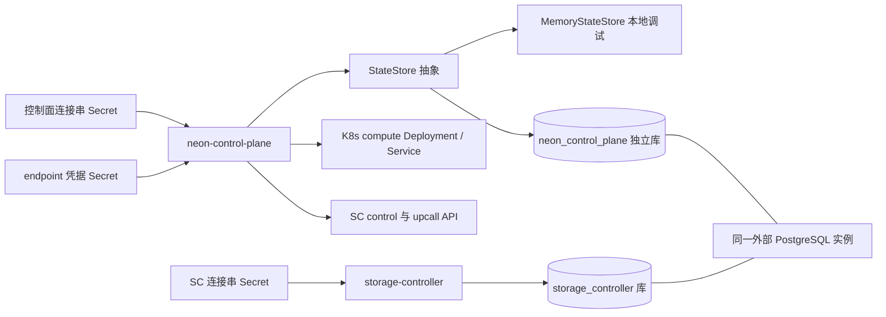

# control-plane详细设计方案

> **文档状态**：本文是 `neon-control-plane` 持久化层改造为「外部 PostgreSQL、独立库」的**设计方案，尚未实施**。文中所有表结构 DDL、配置项、代码改造点均为后续实施内容；本次交付仅此一份文档，未修改任何 Go 源码、Helm 模板、构建脚本或集群资源。
>
> **适用范围**：`charts/neon-control-plane`（自研最小控制面）的 project / branch / endpoint 元数据持久化。storage-controller 自身的元数据库、pageserver / safekeeper 的数据持久化均不在改造范围内。
>
> **本版修订**：① 项目仍处于开发阶段、**尚未上生产**，不存在需要保留的存量状态，因此**不设计存量数据迁移、双写灰度、兼容快照导入导出与回滚**；旧 ConfigMap 快照（若本地环境存在）可直接丢弃。② **不保留 ConfigMap dev fallback**，运行时只保留 `postgres` 与 `memory` 两种实现。③ 按方案评审意见修订：补充**跨系统事务边界与补偿**、取消单副本阶段的行级乐观锁、拆分卸载清理与数据保留、软删除唯一约束、DDL 迁移并发互斥、凭据热路径缓存、token 有效期策略、独立库初始化步骤、量化验收目标与版本兼容矩阵。
>
> **术语约定**：本文出现的「迁移」一律指 **DDL / schema 版本升级**（`schema_version` 与内嵌迁移脚本），不指数据迁移；如需表达后者会明确写「存量数据导入」。
>
> **写作约定**：沿用 `docs/plan.md` 的中文风格；DDL 字段说明、配置示例与流程注释均使用中文（见仓库根 `AGENTS.md`）。本文不附 Go 代码骨架与完整 SQL 脚本，DDL 以字段表形式给出。

## 0. 决策摘要

| 决策项 | 结论 |
| --- | --- |
| 持久化后端 | 外部 PostgreSQL，创建**独立库 `neon_control_plane`**、独立账号、独立连接串 Secret |
| PG 实例来源 | **复用现有部署前置的外部 PG 实例**，不默认新增一套数据库集群；生产规模或合规需要时可拆为独立实例 / CNPG |
| 与 storage-controller 库的关系 | 同实例、不同 database，**不共用库、不共用账号、不共用 Secret**，理由见第 2.3 节 |
| 旧 ConfigMap 方案 | **整体废弃**：不保留 `neon-cp-state` 快照读写、不保留 ConfigMap 运行时实现；开发 / 本地调试改用 `memory` 或本地 PG |
| 存量数据 | **无**：开发阶段、尚未上生产，空库启动、由内嵌迁移自动建表；不做导入、双写、灰度切换与兼容快照导出 |
| 依赖与构建 | 按已确认约束，**允许联网拉取 Go 依赖、不 vendor**；推荐纯 Go 无 CGO 的 `pgx/v5`，放弃「零第三方依赖 + 完全离线编译」这一既有约束，改造点见第 4.8 节 |
| 跨系统一致性 | **显式 Saga 顺序 + 补偿**：PG 事务只覆盖本地表，SC / K8s / Secret 属外部副作用，按第 4.3.1 节的顺序执行与逆序补偿，禁止「外部失败仅告警后继续」 |
| 并发模型 | 阶段 1–3 单副本下用事务 + 唯一约束 + 幂等 UPSERT，**不引入行级乐观锁**；阶段 4 引入 leader election 后再评估版本列，见第 4.5 节 |
| 凭据治理 | SCRAM 验证器改存 K8s Secret、库中只存引用并加内存缓存；`storage_auth_token` 运行时签发、不落库；阶段 2 不引入 exp，策略见第 5.4 节 |
| 交付边界 | 本次只写文档；实施按第 7 章分阶段推进 |

---

## 1. 背景与现状

### 1.1 当前持久化实现

| 事实 | 依据 |
| --- | --- |
| 唯一持久化载体是 ConfigMap `neon-cp-state` 的 `data["state.json"]`，值为整份 `PersistedState` JSON 字符串 | `charts/neon-control-plane/src/persist.go:61-70`、`src/k8s.go:337` |
| `PersistedState` 顶层只有 `projects` / `branches` / `endpoints` 三个 map | `charts/neon-control-plane/src/types.go:234-240` |
| 运行时真相源是进程内 `state`（3 个 map + `sync.RWMutex`），`snapshot()` 只浅拷贝指针并在锁外序列化 | `src/main.go:41-46`、`src/persist.go:127-147` |
| 写策略为 write-through + 1s 去抖全量覆写；`kubePersist == nil`（非集群内）完全不持久化，状态只在内存 | `src/persist.go:21-39,54-56,84-87` |
| 启动时加载快照，再与 K8s Deployment / Pod、compute_ctl `/status`、storage-controller `tenant_locate` 双向对账 | `src/persist.go:156-195`、`src/reconciler.go:93-157`、`src/status_reconciler.go:68-93` |
| 单写者靠 `replicas: 1` + `Recreate` 拓扑约束，而非协议层并发控制 | `charts/neon-control-plane/templates/deployment.yaml:13-16` |
| ConfigMap 由运行时首次写入创建（Helm 不管理），卸载时由 pre-delete 钩子主动删除 | `src/k8s.go:361-389`、`templates/pre-delete-cleanup-job.yaml:74-77` |
| 创建 project 的顺序是「SC 建 tenant/timeline → 内存态 → 生成 endpoint → K8s 拉起 compute → 最后持久化」，外部失败多为 `logWarn` 后继续 | `src/main.go:278-385` |
| 业务真相源在外部系统：storage-controller（tenant / timeline / 分片路由，自身已依赖外部 PG）、K8s compute 资源、compute_ctl | `src/types.go:9-19`、`docs/plan.md:9`、`charts/neon/templates/NOTES.txt:5-9` |

### 1.2 必须可靠保存、丢失后不可重建的数据

| 数据 | 依据 | 丢失后果 |
| --- | --- | --- |
| `project_id ↔ tenant_id` 映射、项目名与创建时间 | `src/types.go:78-85`、`src/main.go:274-322` | SC 只认 tenant_id，数据仍在 pageserver / S3，但用户再也无法按 project 寻址 |
| `branch_id ↔ (tenant_id, timeline_id)` 映射、父子分支与 default 标记 | `src/types.go:87-98` | 分支不可寻址，父子关系与级联删除语义丢失 |
| `endpoint_id` 及其 project / branch / tenant / timeline 归属、compute 镜像 | `src/types.go:111-118` | compute Deployment 成为孤儿 |
| 初始角色名、数据库名与 owner | `src/spec.go:101-126`、`src/main.go:869-881` | 重建 spec 时会退回默认值，与 compute 内已创建的角色 / 库不一致 |
| SCRAM 验证器（proxy 鉴权用）与明文口令 | `src/main.go:843-848`、`README.md:801-802` | 明文口令仅在创建响应返回一次；验证器丢失后已有客户端无法认证 |

> 结论：这份状态不是「可随意丢弃的缓存」，而是**用户可见资源到存储实体的唯一索引**，可靠性等级应接近数据库而不是 checkpoint。

### 1.3 当前缺陷清单（由新后端整体替代，不再逐项修补旧实现）

| 编号 | 缺陷 | 证据 | 处置方式 |
| --- | --- | --- | --- |
| D1 | 无 `resourceVersion` / CAS，PUT 全量替换；GET→POST/PUT 存在 TOCTOU；HTTP ≥ 300 直接返回错误且无 409 重试 | `src/k8s.go:361-389,408-411` | 删除 ConfigMap 写路径，改事务 + 行级 UPSERT |
| D2 | 写失败前 `dirty` 已清零，仅 `WARN`，变更永久丢失 | `src/persist.go:43-73` | 写失败返回可行动错误、保留待写标记并退避重试 |
| D3 | 加载失败 / JSON 解析失败一律返回 nil，静默空状态启动 | `src/persist.go:79-113` | 生产后端加载失败即 fail fast，不启动 HTTP |
| D4 | `flushPersist()` 定义但无调用者，无 SIGTERM 处理 | `src/persist.go:115-125` | 接线优雅退出与 `Flush` / `Close` |
| D5 | 单键全量快照受 ConfigMap 约 1 MiB 限制，代码无长度检查；每个 endpoint 还带完整 ComputeSpec | `src/persist.go:59-70`、`src/spec.go:11-39` | 行级存储 + 脱敏，消除单 blob 上限 |
| D6 | 无 schema 版本、迁移、备份；`ComputeSpec.FormatVersion` 只是 compute_ctl 协议版本 | `src/types.go:234-240`、`src/spec.go:13` | 新增 `schema_version` 表与内嵌 DDL 迁移 |
| D7 | 浅拷贝 + 锁外序列化，并发修改下有撕裂快照 / data race 风险 | `src/persist.go:59-61,127-147` | 事务内按实体读取，不再序列化整份状态 |
| D8 | SCRAM 验证器（以 `spec.cluster.roles[].encrypted_password` 形式）与 `storage_auth_token` 明文落在 ConfigMap | `src/main.go:837-841,870`、`src/main.go:1181-1187` | 凭据外移到 Secret / 运行时派生，见第 5.4 节 |
| D9 | 单写者依赖部署拓扑，误扩副本会互相覆盖 | `templates/deployment.yaml:13-16` | 事务 + 唯一约束 + 幂等写；阶段 4 评估多副本 |
| D10 | 卸载钩子主动删除状态数据，且 best-effort | `templates/pre-delete-cleanup-job.yaml:74-80` | 删除「删状态 ConfigMap」步骤；**compute 资源清理与持久化数据保留彻底解耦**（第 5.5 节） |
| D11 | 无写失败告警、无持久化可观测性 | `src/persist.go:41-77` | 阶段 2 补指标与告警，见第 4.6 节 |
| D12 | 外部副作用失败仅告警后继续，SC / K8s / 持久化三者可能不一致 | `src/main.go:303-315,357-385` | 第 4.3.1 节的 Saga 顺序与逆序补偿 |

### 1.4 为什么选择外部 PG

外部 PG **已经是本仓库的部署前置条件**：`charts/neon/templates/NOTES.txt:5-9` 把「外部 PostgreSQL（storage-controller 元数据后端）」列为第 1 项外部依赖，`charts/neon/values.yaml:15-20` 通过 `global.storageController.databaseUrl.existingSecret` / `secretKey` 引用连接串，`charts/neon/README.md:167-168` 标注该 Secret 必填，`charts/neon/Chart.yaml:11-35` 的 umbrella 依赖中并没有数据库子 chart。因此本方案的增量是「在同一个外部实例上再建一个独立库 + 一套账号 / Secret / DDL 迁移」，不是从零引入一套新的有状态集群。

上游实现也采用同样的分层：storage-controller 明确「uses a postgres database to persist a subset of its state」（`neon/docs/storage_controller.md:27-35`），RFC 更直白地写明「We rely on an external postgres for all durable state. No local storage is used.」（`neon/docs/rfcs/2025-02-14-storage-controller.md:19-21`），其 `DATABASE_URL` 缺失即启动失败（`neon/storage_controller/src/main.rs:264-280,487-492`），DDL 迁移随进程启动自动执行（`neon/docs/storage_controller.md:50,76-77`）。闭源 Cloud 侧同样有独立的 console db / control-plane db（`neon/docs/rfcs/017-console-split.md:18,85-91`）。本方案让自研控制面的持久化模型与上游保持一致。

### 1.5 本版两项约束及其影响

**（1）开发阶段、无存量数据。** 项目尚未上生产，现有 `neon-cp-state` 中没有需要保留的业务状态；因此方案不含存量数据导入、双写灰度、切换判据、兼容快照导出与「回退到旧 ConfigMap 后端」等路径。开发 / 测试环境直接以**空库启动**，由内嵌迁移自动建表（第 3.7 节），手工构造测试数据即可。若本地已有旧快照，直接删除，不做导入。

**（2）不保留 ConfigMap dev fallback。** 理由：

1. **场景不成立**：集群内部署时外部 PG 是必填前置依赖，不存在「部署了控制面却没有 PG」的合法形态；非集群环境因为要连接 kube-apiserver（`src/k8s.go:40-47` 的 namespace 来自 SA 挂载文件），ConfigMap 后端根本不可用——现有代码在 `kubePersist == nil` 时就是纯内存（`src/persist.go:54-56,84-87`）。
2. **语义漂移**：两套后端能力不对等（事务、唯一约束、容量、并发、凭据模型），开发环境验证通过不代表生产正确，还会与「PG 不可用即 fail fast」的决策冲突。
3. **维护成本**：多实现契约测试、CAS/409、SIGTERM flush、大小检查、ConfigMap RBAC、卸载钩子、双写开关、新旧凭据格式兼容，全都为一套即将废弃的实现买单。
4. **已有更简单的替代**：单测 / 本地调试用 `MemoryStateStore`；需要贴近生产时直接连 `postgres-dev.yaml` 的 PG 或本地容器（用户已允许联网拉依赖）。

> 由此，运行时实现只有 `PostgresStateStore` 与 `MemoryStateStore` 两种；`PersistedState` 结构、`neon-cp-state` ConfigMap 的读写代码、`triggerPersist` 去抖逻辑一并移除，而不是保留为第二套后端。

---

## 2. 架构决策与部署拓扑

### 2.1 决策表

| 编号 | 决策 | 理由 | 代价 / 约束 |
| --- | --- | --- | --- |
| AD-1 | 复用现有外部 PG 实例，创建独立库 `neon_control_plane` | 边际成本低，不新增数据库集群；与 storcon 库隔离 | 共享实例的资源与故障域，需配额与告警隔离 |
| AD-2 | 独立账号 + 独立连接串 Secret，不同 env 名 | 最小权限、独立轮换、避免误连 storcon 库 | 需新增 Secret 与取值链 |
| AD-3 | 内存态仍是运行时真相源，DB 是持久层；启动时全量加载，运行期按实体写 | 保持现有 API、对账逻辑与读性能不变，改造面最小 | 需保证写路径完整覆盖所有变更点 |
| AD-4 | `StateStore` 只保留 PG（生产）与 Memory（单测 / 本地）两种实现 | 无存量数据、无 ConfigMap 可用场景；避免双后端语义漂移与维护成本 | 本地调试需要 PG 时自行起本地实例 |
| AD-5 | 只持久化权威对象与恢复必需状态；**派生观测值与完整 spec 不落库** | 与上游「持久化对象、不持久化关系」的设计一致（`neon/docs/storage_controller.md:29-31`），避免陈旧状态与写放大 | 启动后需靠既有对账重建派生状态 |
| AD-6 | 全量 JSON 快照改为行级事务 UPSERT / DELETE | 消除 1 MiB 上限、写放大、撕裂快照（D5/D7） | 写次数上升，需连接池与批量优化 |
| AD-7 | PG 不可用时 fail fast，禁止静默降级 | 避免 D2/D3 的静默丢数据 | 控制面可用性耦合 PG，需 HA |
| AD-8 | 凭据不在状态载体中明文保存，热路径加缓存 | 关闭 D8，避免每次鉴权打 apiserver | 需 Secret 生命周期、缓存失效与轮换流程 |
| AD-9 | 不做存量迁移、不做双写与兼容快照 | 开发阶段、尚未上生产，无存量状态 | 上线前如需保留开发环境数据，用 PG 备份 / 恢复而非快照 |
| AD-10 | PG 事务只覆盖本地表；SC / K8s / Secret 用显式 Saga 顺序与逆序补偿 | 跨系统无法原子提交，必须定义失败语义（D12） | 需要编排层与补偿失败告警，见第 4.3.1 节 |
| AD-11 | 阶段 1–3 不引入行级乐观锁，靠事务 + 唯一约束 + 幂等 UPSERT + 单写者 | 内存态没有版本号，引入乐观锁会导致版本不同步与活锁 | 阶段 4 多副本前必须补 leader election 或重新引入 DB 权威版本列 |

### 2.2 组件关系图



### 2.3 与 storage-controller 库隔离的理由

`storage_controller` 库保存 pageserver **generation numbers**，上游明确要求该库必须持久、禁止放在 ephemeral local disk，因为 generation 的单调性直接决定数据安全（`neon/docs/storage_controller.md:67-70`；`neon/storage_controller/src/persistence.rs:49-61`；`neon/storage_controller/migrations/2024-01-07-211257_create_tenant_shards/up.sql:1-13`）。因此：

1. **DDL 演进隔离**：控制面业务表的版本升级、内嵌迁移不得与 storcon 的 diesel migrations（`neon/diesel.toml:5,8-9`）互相干扰。
2. **备份隔离**：两个库的 RPO / 保留周期不同；storcon 库应单独备份与恢复演练，避免业务库的高频写入影响其备份窗口。
3. **权限隔离**：控制面账号只对自己的库有权限，即使凭据泄漏也无法改写 generation。
4. **故障域隔离**：控制面连接池打满、慢查询或锁等待不会直接拖垮 storcon 的 generation 递增事务；落地手段见第 9.2 节的语句级超时参数。

> 备注：同实例隔离不等于完全隔离。若生产规模较大或有合规要求，应把控制面库拆到独立 PG 实例 / CNPG 集群；`postgres-dev.yaml:1-3` 已注明开发用的单实例 PG 仅用于测试，生产应使用托管 PG 或 CNPG。

### 2.4 读写路径（改造后）

- **启动**：读取配置 → 连接 PG（失败即退出）→ 用 advisory lock 串行执行内嵌 DDL 迁移 → 一次性加载 projects / branches / endpoints / 凭据引用（固定次数查询，避免 N+1）→ 装配内存 `state` → 执行原有 K8s / SC 对账（派生状态由此重建）→ 启动 HTTP。**空库是正常初始状态**。
- **写**：按第 4.3.1 节的 Saga 顺序执行；PG 事务提交本地实体，SC / K8s / Secret 作为外部副作用在事务外执行并带补偿；仅 `status` 变化由状态对账批量写回，其余派生字段与完整 spec 不落库。
- **读**：API 与 spec 下发继续读内存；`getEndpointAccessControl` 从带缓存的凭据引用装配 `role_secret`，不再依赖 `Spec.Cluster.Roles[0].EncryptedPassword` 回退（现逻辑见 `src/main.go:1181-1187`）。
- **关闭**：SIGTERM → 停止接收新请求 → 停止对账 worker → 刷新待写状态 → 关闭连接池后退出。
- **本地调试**：`backend: memory` 时跳过 PG 与凭据 Secret，仅提供内存态，明确标注「重启丢失」；不得用于任何集群内部署。

---

## 3. 数据模型与 DDL

> 以下 DDL 以字段表形式描述，中文列即为字段注释；实施时折算为 PostgreSQL 建表语句，并在内嵌迁移中按版本管理。**本次不建表、不执行任何 SQL。**

### 3.1 建模原则

1. 一张表对应一类资源，主键为对外 ID；`tenant_id` / `timeline_id` 等 SC 侧标识只作为映射列，不代替本地 ID。
2. 所有 ID 映射列加唯一约束；**软删除场景下唯一约束必须带 `WHERE deleted_at IS NULL`**，否则删除后的映射无法复用。
3. 区分两类字段：**权威 / 恢复字段**（不可重建，必须落库）与**派生字段**（可由 SC、K8s、compute_ctl 对账覆盖，仅保留在内存）。完整 ComputeSpec 与观测状态**不落库**。
4. 不保存 `storage_auth_token`、明文口令、SCRAM 验证器本体；库中只保存凭据 Secret 引用。
5. 保留软删除列与 `operations` 预留表，为后续「回收站 / 恢复窗口 / 异步操作」留出演进空间（`README.md:797-804` 已把「无恢复窗口」列为当前限制）。
6. 迁移只做**加表 / 加列 / 加索引**等 additive 变更，不做破坏性变更，保证 N-1 版本镜像可继续读新库（第 6.2 节兼容矩阵）。

### 3.2 表清单

| 表名 | 用途 | 章节 |
| --- | --- | --- |
| `schema_version` | 记录已应用的 DDL 迁移版本，启动时自动升级 | 3.7 |
| `projects` | project 与 tenant 映射 | 3.3 |
| `branches` | branch 与 timeline 映射、父子关系 | 3.4 |
| `endpoints` | endpoint 身份、恢复必需状态与对外状态 | 3.5 |
| `endpoint_credentials` | 初始角色 / 数据库名与凭据 Secret 引用（不存凭据本体） | 3.6 |
| `operations` | 预留：异步操作与审计（后续版本启用） | 3.6 |

### 3.3 `projects`（项目与 tenant 映射）

| 字段 | 类型 | 约束 / 索引 | 中文注释 |
| --- | --- | --- | --- |
| `project_id` | `VARCHAR(64)` | 主键 | 对外项目 ID |
| `tenant_id` | `VARCHAR(64)` | 非空，部分唯一索引 `uq_projects_tenant_id (tenant_id) WHERE deleted_at IS NULL` | 映射到的 storage-controller tenant，一个 project 一个 tenant |
| `name` | `VARCHAR(255)` | 可空 | 用户指定项目名，对齐 v2 API |
| `created_at` | `TIMESTAMPTZ` | 非空，默认 `now()` | 创建时间 |
| `updated_at` | `TIMESTAMPTZ` | 非空，默认 `now()` | 最后更新时间，由写路径维护 |
| `deleted_at` | `TIMESTAMPTZ` | 可空，普通索引 `idx_projects_deleted_at` | 软删除时间；为空表示有效，预留恢复窗口 |

> 约束说明：唯一约束限定在有效行上，软删除后不会阻塞同名 / 同映射资源重建；所有查询默认带 `deleted_at IS NULL`。删除语义由实施阶段决定（软删除优先），默认对外 API 行为与现在一致。

### 3.4 `branches`（分支与 timeline 映射）

| 字段 | 类型 | 约束 / 索引 | 中文注释 |
| --- | --- | --- | --- |
| `branch_id` | `VARCHAR(64)` | 主键 | 对外分支 ID |
| `project_id` | `VARCHAR(64)` | 非空，外键 → `projects.project_id`，索引 `idx_branches_project_id` | 所属项目，级联清理依据 |
| `tenant_id` | `VARCHAR(64)` | 非空 | SC tenant 标识，冗余以避免联表 |
| `timeline_id` | `VARCHAR(64)` | 非空 | SC timeline 标识 |
| `name` | `VARCHAR(255)` | 非空，默认空串 | 分支名；现实现无 omitempty，空串也序列化 |
| `parent_id` | `VARCHAR(64)` | 可空，自引用外键 `ON DELETE RESTRICT`，索引 `idx_branches_parent_id` | 父分支，用于子分支保护与级联删除 |
| `is_default` | `BOOLEAN` | 非空，默认 `false` | 是否为项目默认分支（main） |
| `created_at` / `updated_at` | `TIMESTAMPTZ` | 非空，默认 `now()` | 创建 / 更新时间 |
| `deleted_at` | `TIMESTAMPTZ` | 可空 | 软删除时间 |

> 约束说明：部分唯一索引 `uq_branches_tenant_timeline (tenant_id, timeline_id) WHERE deleted_at IS NULL` 保证有效行中一个 timeline 只属于一个 branch；部分唯一索引 `uq_branches_default_per_project (project_id) WHERE is_default AND deleted_at IS NULL` 保证每个项目最多一个有效默认分支。`parent_id` 使用 `ON DELETE RESTRICT`，**删除项目 / 分支时必须按「子分支 → 父分支」顺序在同一事务内删除**，禁止直接级联删除父分支（第 4.3.1 节）。

### 3.5 `endpoints`（端点身份与恢复状态）

| 字段 | 类型 | 约束 / 索引 | 中文注释 | 分类 |
| --- | --- | --- | --- | --- |
| `endpoint_id` | `VARCHAR(64)` | 主键 | 对外端点 ID | 权威 |
| `project_id` | `VARCHAR(64)` | 非空，外键 → `projects`，索引 `idx_endpoints_project_id` | 所属项目 | 权威 |
| `branch_id` | `VARCHAR(64)` | 非空，外键 → `branches`，索引 `idx_endpoints_branch_id` | 所属分支 | 权威 |
| `tenant_id` | `VARCHAR(64)` | 非空，索引 `idx_endpoints_tenant_id` | 用于 `/notify-attach` 按 tenant 批量定位端点 | 权威 |
| `timeline_id` | `VARCHAR(64)` | 非空 | 当前 timeline | 权威 |
| `compute_image` | `VARCHAR(512)` | 非空 | 拉起 compute 使用的镜像 | 权威 |
| `status` | `VARCHAR(16)` | 非空，检查约束限定为 `provisioning/running/stopped/failed/unknown` | 对外聚合状态；启动后由状态对账覆盖 | 派生（仅此列落库，供列表 API） |
| `route_fingerprint` | `VARCHAR(128)` | 可空 | SC 路由指纹，判断 spec 是否落后 | 恢复 |
| `safekeeper_generation` | `BIGINT` | 非空，默认 0 | safekeeper 成员配置 generation，用于乱序通知幂等 | 恢复 |
| `pending_reconfigure` | `BOOLEAN` | 非空，默认 `false`，部分索引 `idx_endpoints_pending (endpoint_id) WHERE pending_reconfigure` | 是否存在待推送 spec，重启不丢任务 | 恢复 |
| `created_at` / `updated_at` | `TIMESTAMPTZ` | 非空，默认 `now()` | 创建 / 更新时间 | 权威 |
| `deleted_at` | `TIMESTAMPTZ` | 可空，索引 `idx_endpoints_deleted_at` | 软删除时间 | 权威 |

> 说明：**不落库**的字段包括完整 ComputeSpec、`compute_status`、`status_message`、`ready_replicas`、`last_status_check`、SCRAM 验证器、`storage_auth_token` 与行版本号——前者由 SC / K8s / compute_ctl 对账在内存中重建，后者属于凭据或阶段 4 才评估的并发机制。这样既避免陈旧派生数据，也消除「派生字段变化本身不触发写」带来的不一致。

### 3.6 凭据与预留表

`endpoint_credentials`（端点凭据引用）：

| 字段 | 类型 | 约束 / 索引 | 中文注释 |
| --- | --- | --- | --- |
| `endpoint_id` | `VARCHAR(64)` | 主键 / 外键 → `endpoints`，级联删除 | 所属端点 |
| `role_name` | `VARCHAR(128)` | 非空 | 初始角色名，重建 spec 时不得回退为默认值 |
| `database_name` | `VARCHAR(128)` | 非空 | 初始数据库名 |
| `owner` | `VARCHAR(128)` | 非空 | 数据库 owner |
| `credential_secret_name` | `VARCHAR(253)` | 非空 | 存放 SCRAM 验证器的 K8s Secret 名称，如 `neon-cp-cred-<endpoint_id>` |
| `credential_secret_key` | `VARCHAR(253)` | 非空，默认 `scram_verifier` | Secret 中的键名 |
| `created_at` / `updated_at` | `TIMESTAMPTZ` | 非空，默认 `now()` | 创建 / 更新时间 |

`operations`（预留，后续版本启用）：`operation_id UUID` 主键、`project_id`、`branch_id` 可空、`endpoint_id` 可空、`action VARCHAR(64)`、`status VARCHAR(32)`、`error_message TEXT`、`created_at` / `updated_at TIMESTAMPTZ`，索引 `(project_id, created_at DESC)`。当前实现只在响应里内联 `[]map[string]string{action,status,error}`，没有独立 Operation 实体。

### 3.7 `schema_version` 与内嵌 DDL 迁移策略

| 字段 | 类型 | 约束 / 索引 | 中文注释 |
| --- | --- | --- | --- |
| `version` | `INTEGER` | 主键 | 单调递增的迁移版本号 |
| `description` | `TEXT` | 非空 | 本次迁移的中文说明 |
| `checksum` | `VARCHAR(64)` | 非空 | 迁移脚本内容的 SHA-256，防止已应用脚本被篡改 |
| `applied_at` | `TIMESTAMPTZ` | 非空，默认 `now()` | 应用时间 |

规则：

1. **实现机制**：上游 Rust 的 `embed_migrations!`（`neon/storage_controller/src/persistence.rs:47`）在 Go 侧不可用；采用标准库 `embed.FS` 打包 `src/migrations/*.sql`，配一个轻量 runner（读取 `schema_version` → 按版本顺序在单事务内执行 → 计算并写入 checksum）。建议自研约百行 runner，不再引入第二个迁移框架；若团队选择 `golang-migrate/v4`，需锁定版本并复用同一 `schema_version` 语义。
2. 启动自动执行、无需手工，与 `neon/docs/storage_controller.md:50,76-77` 一致；版本只前进，不自动 down migration；已应用脚本 checksum 不匹配即启动失败并给出可行动错误。
3. **并发互斥**：执行前取 `pg_advisory_xact_lock(<固定键>)`（事务级），多副本 / RollingUpdate 下只有一个实例执行迁移，其余等待；迁移期间控制面不接收请求，迁移失败不允许「降级到空状态启动」。
4. **兼容性约束**：迁移只做 additive 变更（加表 / 加可空列 / 加索引），禁止改列类型、删列、改枚举；保证 N-1 版本镜像仍能读写新库，否则必须先拆成两次发布（第 6.2 节）。
5. 升级路径：备份业务库 → 部署新版本 → 启动自动迁移 → 校验 `schema_version` 与实体计数 → 开放流量。版本回退路径见第 6.2 节。
6. 迁移账号与运行账号分离：迁移期账号拥有 DDL 权限，运行期账号仅拥有表的 SELECT / INSERT / UPDATE / DELETE。

### 3.8 索引与约束汇总

| 对象 | 约束 / 索引 | 目的 |
| --- | --- | --- |
| `projects` | 主键 `project_id`；部分唯一 `uq_projects_tenant_id (tenant_id) WHERE deleted_at IS NULL`；`idx_projects_deleted_at` | ID 唯一、tenant 反查、软删除后可复用映射 |
| `branches` | 主键 `branch_id`；部分唯一 `uq_branches_tenant_timeline`、部分唯一 `uq_branches_default_per_project`（均带 `deleted_at IS NULL`）；`idx_branches_project_id` / `idx_branches_parent_id` | 映射唯一、单默认分支、按项目与父分支查询 |
| `endpoints` | 主键 `endpoint_id`；`idx_endpoints_project_id` / `idx_endpoints_branch_id` / `idx_endpoints_tenant_id`；部分索引 `pending_reconfigure` | 级联删除、notify 按 tenant 批量定位、重配置 worker 扫描 |
| `endpoint_credentials` | 主键 / 外键 `endpoint_id`，级联删除 | 端点删除时凭据引用一并清理 |
| `schema_version` | 主键 `version` | DDL 迁移版本幂等 |

### 3.9 现有字段到关系模型的对照（用于改造，不用于数据导入）

> 本表只用于指导代码改造时「哪些字段需要落到哪张表」，**不代表要把旧 ConfigMap 快照导入 PG**；开发阶段空库启动即可。

| 现状字段（`src/types.go` / `src/spec.go`） | 目标列 / 去向 | 处理方式 |
| --- | --- | --- |
| `projects[*].project_id / tenant_id / name / created_at` | `projects` 同名列 | 新写入时原样落库 |
| `branches[*].branch_id / project_id / tenant_id / timeline_id / name / parent_id / default` | `branches` 同名列（`default` → `is_default`） | 新写入时原样落库，补外键校验 |
| `endpoints[*].endpoint_id / project_id / tenant_id / timeline_id / branch_id / compute_image` | `endpoints` 同名列 | 新写入时原样落库 |
| `Endpoint.Spec`（整份 ComputeSpec） | **不落库** | 由 `buildSpecFromEndpoint` 与 SC 对账在内存重建（`src/main.go:1247-1309`） |
| `spec.cluster.roles[].name` / `databases[].name` / `owner` | `endpoint_credentials` | 原样落库（不可重建） |
| `spec.cluster.roles[].encrypted_password` | K8s Secret，库中存 `credential_secret_name/key` | **移出状态载体** |
| `spec.storage_auth_token` | 运行时签发 | **不落库**；每次构建 spec 时重新签发 |
| `ScramVerifier` / `ScramPassword`（`json:"-"`） | 不落库 | 明文口令仍仅在创建响应返回一次 |
| `status` | `endpoints.status` | 落库供列表 API；启动后由状态对账覆盖 |
| `compute_status / status_message / ready_replicas / last_status_check` | **不落库**，仅内存 | 由 15s 状态对账重建 |
| `route_fingerprint / safekeeper_generation / pending_reconfigure` | `endpoints` 同名列 | 作为恢复字段落库 |
| `Config`（Helm `config.json`）、节点清单、Pod IP / NodePort、JWKS 内存对象 | 不落库 | 由 Helm / SC / K8s / 进程持有 |

---

## 4. Go 侧改造：`StateStore` 抽象与文件清单

### 4.1 职责边界

把 `src/persist.go` 中「全量快照读写」的隐式逻辑替换为显式的 `StateStore` 抽象，并**删除** ConfigMap 快照相关代码。**本文只定义职责，不生成接口代码**。

| 职责 | 说明 | 对应现状 |
| --- | --- | --- |
| `Load` | 启动时一次性加载全部 project / branch / endpoint / 凭据引用，重建内存 `state`；固定次数查询，避免 N+1；空库返回空状态。**派生状态与 spec 由后续对账重建，不在 Load 范围** | `src/persist.go:79-113`、`src/persist.go:156-175` |
| `UpsertProject` / `DeleteProject` | 项目级事务写入 / 删除，含级联分支与端点 | `src/main.go:385,532` |
| `UpsertBranch` / `DeleteBranch` | 分支级事务写入 / 删除，含子→父顺序与父子关系校验 | `src/main.go:639,783` |
| `UpsertEndpoint` / `DeleteEndpoint` | 端点级事务写入 / 删除，含凭据引用行 | `src/main.go:1009,1061` |
| `UpdateRecoveryState` | 更新路由指纹、safekeeper generation、pending 标记 | `src/reconciler.go:153,272,288`、`src/notify.go:93,177` |
| `UpdateObservedStatus` | 仅在 `status` 变化时批量更新该列 | `src/status_reconciler.go:90` |
| `ResolveCredentials` | 按 `credential_secret_name` / `credential_secret_key` 读取 SCRAM 验证器（带缓存），装配 spec 与 `role_secret` | `src/main.go:1181-1187` |
| `Migrate` | 启动时用 advisory lock 串行执行内嵌 DDL 迁移并记录 `schema_version` | 新增能力，参照 `neon/storage_controller/src/service.rs:1671-1683` |
| `Flush` / `Close` | 优雅退出时刷新待写状态、关闭连接池 | `src/persist.go:115-125`（现未接线） |
| `Health` | 连接探活，供 readiness / liveness 与监控使用 | 新增能力 |

边界约定：`StateStore` **不持有业务判断**，也不负责跨系统编排——SC 调用、K8s 资源创建、Secret 创建与失败补偿由第 4.3.1 节的编排层负责；`StateStore` 只负责本地表的事务边界与错误语义。内存 `state` 的结构（`src/main.go:41-46`）与全部 HTTP API 行为保持不变。

### 4.2 两种实现与选择开关

| 实现 | 适用 | 说明 |
| --- | --- | --- |
| `PostgresStateStore` | 生产与集群内开发 / 测试（默认） | 事务 + 行级 UPSERT；连接失败 fail fast；启动时自动建表 |
| `MemoryStateStore` | 单元测试、无 PG 的本地调试 | 纯内存，明确标注「重启丢失」；不连接 PG 与凭据 Secret，不用于集群内部署 |

`backend` 取值仅 `postgres`（默认）与 `memory`；**不提供 `configmap` 取值**，也不提供「PG 不可用时自动降级」开关。版本升级与回退见第 6 章。

### 4.3 写路径改造映射

| 触发点 | 现行为 | 改造后（事务内） |
| --- | --- | --- |
| `src/main.go:385` `POST /projects` | 全量快照 | 插入 `projects` + 默认 `branches` + 自动创建的 `endpoints` + `endpoint_credentials` 引用；外部副作用按第 4.3.1 节顺序执行 |
| `src/main.go:532` `DELETE /projects/{id}` | 全量快照 | 事务内按「端点 / 凭据引用 → 子分支 → 父分支 → 项目」顺序删除或置 `deleted_at`；随后清理外部资源 |
| `src/main.go:639` `POST /projects/{id}/branches` | 全量快照 | 插入 `branches`，校验 `(tenant_id, timeline_id)` 部分唯一与父分支存在 |
| `src/main.go:783` `DELETE /projects/{id}/branches/{bid}` | 全量快照 | 校验无子分支后删除分支及其端点 |
| `src/main.go:1009` `POST /projects/{id}/endpoints` | 全量快照 | 插入 `endpoints` + 凭据引用，凭据本体写 Secret |
| `src/main.go:1061` `DELETE /projects/{id}/endpoints/{eid}` | 全量快照 | 删除端点行与凭据引用，并清理对应 Secret 与缓存 |
| `src/reconciler.go:153` 路由指纹变化 | 全量快照 | `UPDATE endpoints SET route_fingerprint, pending_reconfigure WHERE endpoint_id = ?`（无版本列） |
| `src/reconciler.go:272,288` pending 标记 | 全量快照 | 同上，仅更新 `pending_reconfigure` |
| `src/status_reconciler.go:90` status 变化 | 全量快照 | 批量 `UPDATE endpoints SET status WHERE ...`；其它观测字段只改内存 |
| `src/notify.go:93,177` notify 回调 | 经 `markPendingReconfigures` 触发全量快照 | 走 `UpdateRecoveryState`；generation 单调校验（`src/notify.go:158-163`）保持不变 |
| `src/main.go:1137-1152` `getComputeSpec` 自愈 | 只改内存、未触发落盘 | **仍只改内存 + 置 `pending_reconfigure` 标记，不落库**；由 30s 对账 / worker 统一写库，避免在被 compute_ctl 周期轮询的 GET 路径（`src/main.go:181-183,1122-1123`）引入 DB 写与失败放大 |

> 事务规则：跨表变更在同一事务内完成；写失败保留待写标记并按退避重试；禁止像现在这样在写之前清除 dirty 后仅打日志（`src/persist.go:43-73`）。

### 4.3.1 跨系统事务边界与补偿（P0）

PG 事务只能覆盖本地表。SC（`POST /v1/tenant`、`/v1/tenant/{id}/timeline`）、K8s（Deployment / Service）、凭据 Secret 都是外部副作用，必须定义**执行顺序、幂等键与逆序补偿**，否则会出现「SC 已建 tenant、DB 无记录」或「DB 有 endpoint、compute 未拉起」等不一致（现状 `src/main.go:303-315,357-385` 对外部失败只告警后继续，必须一并修正）。

**创建 project 的顺序（Saga）**：

| 步 | 动作 | 幂等 / 失败语义 | 逆序补偿 |
| --- | --- | --- | --- |
| 1 | 生成 `project_id` / `tenant_id` / `timeline_id` / `branch_id` / `endpoint_id` 与凭据 | 纯内存，无副作用 | — |
| 2 | 创建凭据 Secret `neon-cp-cred-<endpoint_id>` | 已存在则覆盖同名键；失败即返回 5xx | 删除 Secret |
| 3 | 调 SC 创建 tenant，再创建 timeline | 409 视为已存在（沿用 `src/main.go:291,308`）；其它失败即返回 5xx | 删 timeline → 删 tenant |
| 4 | **PG 事务提交** project / branch / endpoint / 凭据引用 | 主键冲突视为幂等重放；失败即返回 5xx | 删除已写入的业务行 |
| 5 | 创建 K8s Deployment / Service（及可选外部 Service） | 409 视为已存在；失败**不再 `logWarn` 后继续**，返回 5xx 并触发补偿 | 删 Service / Deployment / Pod |
| 6 | 返回 201 | 只有全部步骤成功才返回成功 | — |

**删除 project 的顺序**：先在 PG 事务内按依赖顺序删除本地行（含凭据引用），再依次清理凭据 Secret、K8s Service / Deployment、SC timeline / tenant；任一步失败记录到**待清理队列**并告警，不阻塞对外「已删除」语义，但必须可观测、可重试。

**补偿失败处理**：补偿动作本身可能失败（apiserver / SC 不可用），需持久化或至少在内存中保留重试项，配合指数退避与告警；阶段 3 的故障注入必须覆盖「每个步骤单独失败」与「补偿失败」两类场景。`StateStore` 不参与编排，新增编排层（建议 `src/orchestration.go`）集中管理该状态机，避免散落在各 handler。

### 4.4 启动与关闭

1. 读取 `config.json` 与环境变量；**生产模式缺少连接串 Secret 时直接退出**，错误信息说明缺少的具体配置键，不打印连接串内容。
2. 建立连接池（连接超时、最大连接数、空闲回收、`statement_timeout`），`Health` 探测失败按退避重试，超过阈值即启动失败（对齐 `neon/storage_controller/src/main.rs:275-280,488-490` 的 fail fast）。
3. 取 advisory lock 后执行内嵌 DDL 迁移；**空库是正常初始状态**，无需任何数据导入；迁移失败即退出。
4. `Load` 全量装配内存态；`ResolveCredentials` 预热凭据缓存；随后执行现有 K8s 状态对账与 SC 路由对账（`src/persist.go:177-195`、`src/reconciler.go:47-55`），派生状态与 spec 在此阶段重建。
5. 启动 HTTP 与周期对账；SIGTERM 时按第 2.4 节顺序优雅退出，调用 `Flush` / `Close`（补上 `src/persist.go:115-125` 缺失的接线）。

### 4.5 并发与一致性

- **阶段 1–3（单副本）**：保留 `templates/deployment.yaml:14-16` 的 `replicas: 1 + Recreate`；写正确性由**事务 + 唯一约束 + 幂等 UPSERT**保证，**不引入行级乐观锁**——内存 `Endpoint` 无版本字段，若加 `WHERE version = ?` 又不与内存同步，会造成持续冲突 / 活锁。
- **阶段 4（多副本）**：先引入 K8s Lease leader election（需 `coordination.k8s.io/leases` 的 get/create/update 权限，见第 5.2 节），仅 leader 执行写与对账；若届时确需行级版本列，必须明确「DB 为版本权威，写成功后同步内存，冲突时以 DB 重载」，否则不得引入。`Recreate` → `RollingUpdate` 之前必须完成并发写、双主与迁移并发演练。
- **DDL 迁移并发**：由第 3.7 节的 advisory lock 串行化，滚动更新时新旧 Pod 不会同时改表。
- **禁止静默降级**：PG 不可用时写 API 返回明确错误（建议 503 + 可重试提示），启动不进入就绪状态；不得回退到内存 / ConfigMap 继续提供写服务。

### 4.6 可观测性与性能

| 类别 | 要求 |
| --- | --- |
| 指标 | 持久化写次数 / 延迟 / 失败数、连接池使用率、待写队列长度、`schema_version` 当前版本、`pending_reconfigure` 数量、**凭据缓存命中率 / 失效次数**、**补偿队列积压与失败数**、PG 探活状态 |
| 日志 | 连接串、JWT、SCRAM 验证器、明文口令一律脱敏；错误日志给出可行动信息（缺哪个 Secret / 哪张表 / 哪个版本 / 哪个 Saga 步骤） |
| 告警 | 写失败持续、DDL 迁移卡住、`schema_version` 落后、凭据 Secret 缺失、连接池耗尽、PG 探活失败、**补偿重试超过阈值**；阈值在阶段 3 测得基线后确定 |
| 数据库防护 | `statement_timeout`、`idle_in_transaction_session_timeout`、连接池上限与慢查询日志，避免拖垮同实例的 storcon 库（呼应第 2.3 节） |
| 加载性能 | `Load` 用固定次数查询取四张表并一次性装配内存，禁止 N+1；加载期间不对外提供读 |
| 写性能 | 按实体 UPSERT；`status` 变化批量 UPDATE 合并提交；`getComputeSpec` 不写库；保持 `reconcileIntervalSeconds=30`、`statusReconcileIntervalSeconds=15` 不变（`values.yaml:47,56`），不扩大对账范围 |
| 影响面 | 不改动 HTTP API、SC 通知协议、compute spec 结构与对账业务判断；`src/main.go:144-203` 的路由映射保持不变 |

### 4.7 文件改动清单（后续实施）

| 文件 | 改动 | 处置缺陷 |
| --- | --- | --- |
| `src/persist.go` | 删除 `triggerPersist` / `doPersist` / `loadPersistedState` / `snapshot` 等 ConfigMap 快照逻辑，改为 `StateStore` 初始化、生命周期管理与 SIGTERM flush 接线 | D2/D3/D4/D7 |
| `src/store_postgres.go`（新增） | 连接池、DDL 迁移、事务、实体级 UPSERT / DELETE、批量 status 更新、Health | D1/D5/D6/D7 |
| `src/store_memory.go`（新增） | 单测 / 本地调试用的纯内存实现，显式标注重启丢失 | — |
| `src/migrations/`（新增目录）与迁移 runner | `embed.FS` 打包版本化 SQL、advisory lock、事务、checksum，中文注释 | D6 |
| `src/orchestration.go`（新增） | 第 4.3.1 节的 Saga 编排、幂等键、逆序补偿与待清理队列 | D12 |
| `src/k8s.go` | 保留 compute Deployment / Service 操作；**删除** `readConfigMap` / `upsertConfigMap` 与状态 ConfigMap 常量；新增凭据 Secret 读写与缓存失效；`sendJSON` 错误语义（`src/k8s.go:408-411`）由调用方统一重试 | D1/D8 |
| `src/main.go` | 启动时初始化 `StateStore`、迁移、加载、凭据预热；6 处写触发点改为编排层调用；外部失败不再仅告警后继续；`getEndpointAccessControl` 改从凭据缓存取值 | D2/D8/D12 |
| `src/reconciler.go` / `src/status_reconciler.go` / `src/notify.go` | 触发点改为 `UpdateRecoveryState` / `UpdateObservedStatus`；业务判断保持；`getComputeSpec` 自愈只改内存 + 标 pending | D2 |
| `src/types.go` / `src/spec.go` | 删除 `PersistedState` 等快照专用结构；新增凭据引用字段；**不新增行版本字段**；ComputeSpec 序列化排除 token 与 verifier | D8 |
| `src/go.mod` / `src/go.sum` | 新增 PG 驱动依赖并锁定版本 | 依赖改造 |
| `build.sh` / `src/Dockerfile` | 见第 4.8 节 | 依赖改造 |
| `charts/neon-control-plane/values.yaml` / `templates/*` | 见第 5 章 | 配置改造 |
| `charts/neon-control-plane/README.md` | 更新技术实现、持久化机制、当前限制三处描述，删除 ConfigMap 快照说明 | 文档一致性 |

### 4.8 依赖选型与构建链（已确认允许联网拉依赖）

| 项 | 结论 |
| --- | --- |
| 驱动 | 推荐 `github.com/jackc/pgx/v5`：纯 Go、无 CGO，与 `CGO_ENABLED=0` 静态编译兼容；也可使用 `database/sql` + `lib/pq`。**必须锁定具体版本并写入 `go.sum`，禁止 `latest`** |
| Go 版本 | `src/go.mod:1-3` 当前为 `go 1.21`；阶段 1 需验证所选 `pgx/v5` 版本的 `go.mod` 要求，若高于 1.21 则升级 `go` 指令并同步 CI 工具链，结论写入实施记录 |
| 迁移框架 | 采用标准库 `embed.FS` + 自研轻量 runner（第 3.7 节），不再引入第二个迁移框架；若改用 `golang-migrate/v4`，需重新评审版本表语义与依赖 |
| `build.sh` | `build.sh:7,57-62` 的「go.mod 零第三方依赖，可完全离线编译，无需 go mod download」注释必须改写；在 `build.sh:65` 的 `go build` 之前增加 `go mod download`（或 `go mod tidy` + `go mod download`），构建机需能访问 GOPROXY |
| `src/Dockerfile` | 现状（`src/Dockerfile:1-12`）只 `COPY` 编译好的静态二进制，构建上下文仍是 `src/`，**不需要引入多阶段 Go 构建**；注释更新为「依赖由构建机联网拉取后静态编译」，`go.mod` / `go.sum` / `migrations/` 随上下文进入不影响镜像 |
| 镜像构建 | `build.sh:74` 的 `docker build` 上下文不变；私有仓库地址与 tag 约定（`build.sh:31-34`）不变 |
| CI / 离线环境 | CI 需允许访问模块代理并缓存 Go module cache；契约测试需真实 PG（CI service 或 testcontainers），`memory` 实现不能替代事务 / 约束 / 死锁测试。**严格离线环境不再能直接构建**，需自备内部 GOPROXY / 预置 module cache，或临时改用 vendor（与本次「不 vendor」决策冲突，需单独评审） |
| 明确权衡 | 放弃「零第三方依赖 + 完全离线静态编译」这一既有能力，换取事务化持久化；`CGO_ENABLED=0` 与镜像基础 `alpine:3.20` 保持不变 |

---

## 5. Helm、Secret 与凭据配置

### 5.1 新增配置键（后续实施示例，非本次改动）

沿用现有约定：连接串只通过 Secret 引用，不进 values、不进 ConfigMap、不进 Helm release；取值链参照 `charts/neon-storage-controller/templates/_helpers.tpl:94-122` 的 `dig + default dict` 写法。

```yaml
# 以下为后续实施时的 values 结构示意，注释使用中文
global:
  controlPlane:
    databaseUrl:
      # 独立连接串 Secret 名称，指向 neon_control_plane 库
      existingSecret: "neon-control-plane-pg"
      # Secret 中存放连接串的键名，与 CloudNativePG / docs 示例一致
      secretKey: "uri"

neon-control-plane:
  settings:
    stateStore:
      # 持久化后端：postgres（生产与集群内测试） / memory（本地调试，重启丢失）
      backend: postgres
      # 子 chart 独立部署时可覆盖全局 Secret 名称与键名
      databaseUrlSecretName: ""
      databaseUrlSecretKey: "uri"
      # 连接超时与连接池上限
      connectTimeoutSeconds: 5
      maxConnections: 8
  cleanup:
    # 卸载时是否清理 compute Deployment / Service / 残留 Pod，默认 true；
    # 与持久化数据保留无关（PG 库与 Secret 不由 Helm 管理）
    computeResources: true
```

> 评审修正：删除上一版的 `cleanup.preserveState`。该开关曾同时控制「compute 资源清理」与「数据保留」，默认 true 会导致卸载后残留 compute 负载，且「彻底清理要设 false」与参数名直觉相反。数据保留无需开关，compute 资源清理单独由 `cleanup.computeResources` 控制。

### 5.2 模板改造清单

| 文件 | 改动 | 依据 / 约束 |
| --- | --- | --- |
| `templates/_helpers.tpl`（新增定义） | 增加 `databaseUrlSecretName` / `databaseUrlSecretKey` 取值链：`settings.stateStore.*` → `global.controlPlane.databaseUrl.*` → 默认键 `uri`；**未配置名称 / 键时渲染期 `fail`**，错误信息指明缺失键 | 参照 `charts/neon-storage-controller/templates/_helpers.tpl:109-111,120-122` |
| `templates/deployment.yaml` | 通过 `env.secretKeyRef` 注入 `NEON_CP_DATABASE_URL`（避免与其它组件的 `DATABASE_URL` 混淆）；readiness 增加 `StateStore.Health`；Secret 缺失时不用 `optional: true`，保持 fail fast。**Helm 只能校验配置，集群中 Secret 对象不存在时由 Pod 启动失败暴露** | 参照 `charts/neon-storage-controller/templates/deployment.yaml:5-8,208-212`；`charts/neon/templates/NOTES.txt:56-61` |
| `templates/configmap.yaml` | 在 `config.json` 中输出 `backend`、超时与连接池等**非敏感**配置；绝不写入连接串 | 现状 `templates/configmap.yaml:4,11-24` 全部取自 `.Values.settings.*` |
| `templates/serviceaccount.yaml` | 删除 `configmaps` 相关动词；保留 deployments / pods / services 权限，新增凭据 Secret 的 `get/create/update/delete`；**阶段 4 追加 `coordination.k8s.io/leases` 的 get/create/update**；评估把 ClusterRole / ClusterRoleBinding（`templates/serviceaccount.yaml:15-47`）收敛为 namespaced Role | 现状 `configmaps` 规则见 `templates/serviceaccount.yaml:28-32` |
| `templates/pre-delete-cleanup-job.yaml` | 保留清理 compute Service / Deployment / 残留 Pod 三步（由 `cleanup.computeResources` 控制，默认 true），**删除「删除状态 ConfigMap」步骤与 `STATE_CONFIGMAP` 变量**；钩子不再触碰任何持久化数据 | 现状 `templates/pre-delete-cleanup-job.yaml:60-90` |
| `charts/neon/templates/NOTES.txt` | 部署前置依赖新增第 4 项：控制面独立库连接串 Secret；安装示例补充 `--set global.controlPlane.databaseUrl.existingSecret=...`；补充库 / 账号初始化步骤指引 | 现状 `charts/neon/templates/NOTES.txt:5-9,33-40` |
| `charts/neon/values.yaml` | 新增 `global.controlPlane.databaseUrl` 段，与 `global.storageController.databaseUrl`（`:15-20`）并列，两者指向不同 Secret、不同库 | 现状 `charts/neon/values.yaml:15-20` |
| `docs/neon.yaml` / `postgres-dev.yaml` | 新增控制面 Secret 示例 `neon-control-plane-pg`（键 `uri`）；并给出**可执行的 `CREATE DATABASE neon_control_plane` / `CREATE ROLE` / `GRANT` 初始化步骤**，明确由集群侧在部署前执行（开发用单实例 PG 与生产托管 PG 各一份） | 现状 `docs/neon.yaml:29-42`、`postgres-dev.yaml:1-3`；解决「空库启动前提未落地」 |

### 5.3 Secret 契约

| Secret | 键 | 指向 | 管理者 |
| --- | --- | --- | --- |
| `storage-controller-pg-cluster`（已有） | `uri` | `storage_controller` 库 | 集群侧预建，chart 只引用 |
| `neon-control-plane-pg`（新增） | `uri` | `neon_control_plane` 库 | 集群侧预建，chart 只引用 |
| `neon-cp-cred-<endpoint_id>`（运行时动态创建） | `scram_verifier` | 单个端点的 SCRAM 验证器 | 控制面创建 endpoint 时创建，删除 endpoint 时清理并失效缓存 |

连接串轮换流程与现有 SC 一致：更新 Secret → `kubectl rollout restart deploy/<release>-neon-control-plane` → 观察 `Health` 与 `schema_version`（env 注入的 Secret 在运行期不会自动刷新，见 `charts/neon/templates/NOTES.txt:56-61`）。

### 5.4 凭据治理（D8）

| 凭据 | 现状 | 改造后 |
| --- | --- | --- |
| 明文 SCRAM 口令 | 生成后仅在创建响应返回一次，未落盘（`src/main.go:844`） | 保持不变，仍不落库 |
| SCRAM 验证器 | 以 `spec.cluster.roles[].encrypted_password` 明文落在 ConfigMap 快照（`src/main.go:870`），重启后由 `src/main.go:1181-1187` 回退读取 | 写入 `neon-cp-cred-<endpoint_id>` Secret；库只存引用；`ResolveCredentials` **带内存缓存**（key 为 Secret 名 + 键），删除 endpoint / 轮换时失效，避免 `get_endpoint_access_control`（`src/main.go:193-194`）每次连接鉴权都打 apiserver；补命中率与失效次数指标 |
| `storage_auth_token` | `signWithTenant`（`src/jwt.go:53-72`）签发的 token 只有 `scope` / `tenant_id`，**没有 exp**；随 spec 落盘（`src/main.go:837-841,863`） | **不落库、不落快照**，每次构建 spec 时重新签发；**阶段 2 保持无 exp**，与现状一致（Ed25519 确定性签名使重新签发结果相同）；若将来引入 exp，必须先实现刷新链路（`/configure` 重推 spec 或 compute 重启）并纳入测试，否则长连接会过期。仅 `signComputeToken` 现有 1h TTL（`src/jwt.go:132-170`）保持不变 |
| Ed25519 私钥 / 公钥 | 外部预建的共享 JWT Secret，Deployment 只投影 `privateKey.pem` / `publicKey.pem`（`templates/deployment.yaml:96-108`） | 保持不变；密钥轮换需按上述刷新链路重推 spec |
| 日志 / 指标 | 无脱敏规范 | 连接串、token、verifier、口令一律不打印；错误只给配置键名与对象名 |

> 提示：K8s Secret 同样由 apiserver 落在 etcd，需集群启用静态加密（EncryptionConfiguration）并收紧 RBAC（第 9.2 节列为验收项）；Secret 方案相对 ConfigMap 的价值在于独立类型语义、独立 RBAC 与可单独配置加密 / 审计，而不是「自动加密」。

### 5.5 卸载、升级与数据保留

1. `helm uninstall` **不删除任何持久化数据**：PG 库、两个连接串 Secret、凭据 Secret 一律不由 Helm 生命周期管理（`charts/neon/README.md:58` 已说明外部依赖不随 release 删除）；因此**不需要 `preserveState` 开关**。
2. pre-delete 钩子负责清理 compute Deployment / Service / 残留 Pod，由 `cleanup.computeResources` 控制（默认 `true`）；**该开关与数据保留完全无关**，默认行为与现状一致，避免卸载后残留 compute 负载。
3. 需要彻底清理数据时，必须显式备份后单独删除 PG 库与 Secret；文档给出命令与风险提示，钩子不参与。
4. 升级路径：备份库 → 部署新镜像 → 启动自动 DDL 迁移 → 校验 `schema_version` 与实体计数 → 开放流量。
5. 版本回退路径见第 6.2 节：不执行自动 down migration，回退镜像并从备份恢复库。

---

## 6. 开发阶段初始化、版本回滚与故障处置

### 6.1 初始化（无存量数据）

| 前置条件 | 说明 |
| --- | --- |
| 外部 PG 已就绪 | 复用 `charts/neon/templates/NOTES.txt:5-9` 要求的外部实例 |
| 库 / 账号已创建 | 由集群侧按 `docs/neon.yaml` / `postgres-dev.yaml` 的初始化步骤执行 `CREATE DATABASE / CREATE ROLE / GRANT`；运行账号仅 DML 权限，迁移账号另设 DDL 权限（第 3.7 节） |
| Secret 已预建 | `neon-control-plane-pg`（键 `uri`）通过 `global.controlPlane.databaseUrl.existingSecret` 引用，chart 只引用不创建 |
| 旧快照可直接丢弃 | 若本地 / 开发环境仍存在 `neon-cp-state` ConfigMap，直接删除即可；**不导入、不导出、不双写** |

流程：部署新版本 → 启动连接 PG → advisory lock 保护下自动建表 → `Load` 得到空状态 → 正常对外服务。开发 / 测试数据通过 API 创建，或直接构造 PG 测试数据；本地无 PG 时用 `backend: memory`，但需明确「重启丢失、不验证持久化行为」。

### 6.2 版本升级与代码回退

| 场景 | 动作 |
| --- | --- |
| 常规升级 | 备份业务库 → 部署新镜像 → 启动自动 DDL 迁移 → 校验 `schema_version` 与实体计数 → 开放流量 |
| 代码回退（镜像降级） | 不执行自动 down migration；备份当前库 → 回退到旧版本镜像 → 若旧版本期望的 schema 不兼容，从对应版本的备份恢复库 → 校验后开放流量 |
| 库结构与代码不兼容 | 以「备份恢复」为准，禁止手工改表绕过 `schema_version`；必要时在开发环境重放 DDL 演进后再升级 |
| 数据库误操作 / 数据损坏 | 从备份恢复（PITR 优先），恢复后执行 K8s / SC 对账，核对 tenant / timeline 映射 |

**版本兼容矩阵（评审补充）**：由于第 3.1 / 3.7 节限定迁移只做 additive 变更，`N` 版镜像可读 `N` 与 `N+1` 版 schema，`N-1` 版镜像可读 `N` 版 schema；破坏性变更必须拆成两次发布（先加列并双兼容，再在后续版本移除旧列）。矩阵随每次迁移更新，并在阶段 3 的回退演练中逐项验证。

**回退演练通过标准**：实体计数与 ID 集合一致、无孤儿 tenant / timeline / Deployment、API list/get 回归通过、`schema_version` 与镜像期望版本匹配、无未收敛的 `pending_reconfigure`。备份建议基线：每日全量备份 + PITR，恢复演练至少每季度一次；具体 RPO / RTO 由阶段 3 评审确认并写入运维手册。

> 由于没有存量数据与双写期，版本回退不涉及「回退到旧 ConfigMap 后端」；PG 库始终保留，不做删库重建。

### 6.3 故障处置

| 故障 | 期望行为 | 处置 |
| --- | --- | --- |
| PG 连接串 Secret 未配置 | 渲染期 `fail`；已运行时启动失败并给出缺失键名 | 补齐 values 后重新部署 |
| PG 连接串 Secret 对象不存在 | Pod `CreateContainerConfigError`，不进入就绪 | 创建 Secret 后重启 Pod |
| PG 不可达（启动） | fail fast，不进入就绪、不加载空状态、不降级到内存后端 | 恢复 PG；本地调试可显式用 `backend: memory`，但不得用于集群内部署 |
| PG 不可达（运行期写） | 写 API 返回可重试错误，保留待写标记并按退避重试；读仍可用 | 告警；恢复后由重试与周期对账收敛 |
| DDL 迁移失败 / checksum 不匹配 / 多实例竞争 | 启动失败或等待 advisory lock，日志给出版本号与期望校验和 | 修正迁移脚本或恢复备份库；不跳过迁移 |
| Saga 任一步失败 | 返回 5xx 并按第 4.3.1 节逆序补偿；不允许「部分成功」 | 补偿失败进待清理队列 + 告警 + 退避重试 |
| 凭据 Secret 缺失 / 缓存失效 | `ResolveCredentials` 返回明确错误并回源一次，不回退到空 `role_secret` | 从备份恢复 Secret 或重建 endpoint |
| 进程在写窗口内被 kill | 重启后从 PG 恢复，未确认的写由待写状态 / 对账补齐 | 纳入故障注入测试 |
| 并发写同一 endpoint | 唯一约束 + 幂等 UPSERT，无覆盖丢失 | 纳入并发测试 |
| apiserver 不可达 | 状态读写仍可用（凭据走缓存）；compute 资源操作受限 | 与现有 K8s 依赖一致，纳入告警 |
| `getComputeSpec` 期间 PG 抖动 | spec 接口仍可用（不写库），自愈只改内存 | 由 30s 对账在 PG 恢复后补写 |

### 6.4 数据保留与清理

- `helm uninstall` 后 PG 库与 Secret 保留；钩子只按 `cleanup.computeResources` 清理 compute 资源。
- 开发环境重置：删库即可（无存量业务数据），重新部署会自动建表。
- 生产化之前必须补齐第 9.2 节的备份与恢复演练，否则不得承载真实数据。

---

## 7. 分阶段实施

| 阶段 | 目标 | 主要改动 | 验收要点 | 可回滚性 |
| --- | --- | --- | --- | --- |
| **阶段 1：抽象与构建链** | 引入 `StateStore`、编排骨架，打通联网依赖构建 | 抽出接口与 PG / Memory 两种实现骨架；删除 ConfigMap 快照代码；新增 `orchestration.go` 的 Saga 骨架与 `embed.FS` 迁移 runner；`go.mod` / `go.sum` 增加 PG 驱动并验证 Go 版本；改写 `build.sh:57-62` 并增加 `go mod download`；CI 增加模块代理、缓存与真实 PG service | 两种实现通过同一组契约测试；Saga 步骤可单测；镜像仍为 `CGO_ENABLED=0` 静态二进制 | 高：改动集中在持久化层，可回退提交 |
| **阶段 2：PG 实现与 Helm** | 独立库可用、端到端跑通 | 新增 `PostgresStateStore`、内嵌 DDL 迁移与第 3 章全部表；库 / 账号初始化步骤；`values.yaml` / `_helpers.tpl` / `deployment.yaml` / RBAC / NOTES / Secret 契约落地；凭据外移与缓存；编排补偿完整实现；fail fast、Health、指标与日志脱敏 | 空库启动自动建表；PG 断开时启动失败并给出可行动错误；`helm lint/template` 通过且未配置 Secret 时渲染 fail；GET spec 路径不写库 | 中：`backend: memory` 可临时用于本地调试，生产不降级 |
| **阶段 3：测试与上线前演练** | 验证正确性、灾备与回归 | 第 8 章全部测试；Saga 分步失败与补偿失败注入；备份恢复演练；版本升级 / 镜像回退演练与兼容矩阵验证；E2E 回归；RBAC 与卸载检查；测得性能基线并确定告警阈值 | 验收标准逐条通过；无孤儿资源；无静默丢数据；性能基线不劣化 | 高：尚无生产数据，可随时重建环境 |
| **阶段 4：HA 与多副本** | 去掉单写者约束 | K8s Lease leader election + `leases` RBAC；`Recreate` → `RollingUpdate`；DDL 迁移 advisory lock 演练；PG HA / 备份 PITR；告警与巡检；如需行级版本列，按第 4.5 节明确 DB 权威与内存同步后再引入 | 并发写、Pod 驱逐、滚动更新、迁移并发、PG 主备切换演练通过；无双主写入 | 中：可先退回单副本 |

阶段依赖：1 → 2 → 3 → 4。阶段 3 完成后才允许接入真实数据；在此之前环境可随时清空重建，这也是本次不做存量迁移方案的前提。

---

## 8. 测试与验收

### 8.1 单元测试

- `StateStore` 契约测试：同一组用例分别跑 `postgres` / `memory` 实现，覆盖 CRUD、级联、幂等 UPSERT、唯一约束冲突、批量 status 更新（**不测乐观锁，因阶段 1–3 不引入版本列**）。
- DDL 迁移测试：版本顺序执行、重复执行幂等、checksum 不匹配即失败、additive 变更的 N-1 兼容、advisory lock 并发互斥。
- 空库启动测试：业务表为空时 `Load` 返回空状态、不报错、不触发任何数据导入。
- 编排测试：Saga 每一步单独失败时补偿动作被正确调用；外部 409 视为幂等成功。
- 凭据测试：脱敏后的 spec 不含 `storage_auth_token` / `encrypted_password`；`ResolveCredentials` 缓存命中与失效；Secret 缺失时返回明确错误。
- 字段映射测试：第 3.9 节每一行都有断言，防止新旧结构漂移。

### 8.2 集成与故障注入

| 场景 | 期望 |
| --- | --- |
| 启动期 PG 不可达 / 连接串错误 | 启动失败、不进入就绪、日志不打印连接串、不降级到内存后端 |
| 运行期 PG 断连后恢复 | 写返回可重试错误、待写标记保留、恢复后重试与周期对账收敛 |
| DDL 迁移失败 / `schema_version` 落后 / 双 Pod 同时启动 | 拒绝启动或按 advisory lock 串行，不降级为空状态 |
| Saga 第 2/3/4/5 步分别失败 | 逆序补偿执行完毕，无孤儿 tenant / timeline / Deployment / Secret |
| 补偿动作本身失败 | 进入待清理队列并告警，重试可收敛 |
| 凭据 Secret 被删 / 缓存失效 | 回源一次后仍返回明确错误或正确 `role_secret`，不回退为空字符串 |
| apiserver 不可达 | 状态读写仍可用（凭据缓存）；compute 相关操作受限并告警 |
| 进程在写窗口内被 kill | 重启后从 PG 恢复，未确认的写由待写状态 / 对账补齐 |
| 并发写同一 endpoint | 唯一约束 + 幂等 UPSERT，无覆盖丢失 |
| `getComputeSpec` 期间 PG 抖动 | spec 接口仍可用，自愈只改内存，恢复后由对账补写 |
| 备份恢复 | 实体计数与映射关系一致，SC / K8s 对账收敛 |

### 8.3 端到端回归

1. `POST /projects` → 自动创建 tenant / timeline / 默认 branch / endpoint → 连接 compute 成功。
2. 创建子分支、只读端点、删除分支与项目，验证级联顺序与 SC / K8s 侧资源一致。
3. 触发 `/notify-attach` / `/notify-safekeepers`，验证 generation 单调校验、路由指纹与 `POST /configure` 重配置链路不受持久化改造影响（`src/notify.go:158-163`、`src/reconciler.go:172-190`）。
4. 控制面重启后：project / branch / endpoint 映射完整恢复、spec 可重新签发、proxy 鉴权 `role_secret` 有效。
5. `getComputeSpec` 自愈路径（`src/main.go:1104-1164`）重建的 spec 在进程内生效；重启后由 30s 对账重建，不依赖 DB 中的 spec 缓存。

### 8.4 Helm 与部署校验

- `helm lint charts/neon` 与 `helm template` 通过；**未配置**控制面 Secret 名称 / 键时渲染期 `fail` 且错误信息指明配置键；Secret 对象不存在时由 Pod 启动失败暴露。
- 渲染结果检查：连接串只以 `secretKeyRef` 出现，不出现在 values、ConfigMap、日志配置或 release 元数据中。
- RBAC 复核：不含任何 `configmaps` 动词；凭据 Secret 权限限定到必要动词；阶段 4 追加 `leases` 权限后复核；评估 ClusterRole 是否收敛为 Role。
- 卸载演练：`helm uninstall` 后 PG 库、两个连接串 Secret、凭据 Secret 与状态数据保留，compute 资源按 `cleanup.computeResources` 被清理。

### 8.5 验收标准（逐条可验证）

1. 第 1.3 节 D1–D12 全部由新实现解决，代码中不再存在 `neon-cp-state` / `state.json` / `triggerPersist` 等旧快照逻辑。
2. 六类 CRUD 与全部对账 / 通知触发点均改为实体级持久化（对照 `src/main.go:385,532,639,783,1009,1061`、`src/reconciler.go:153,272,288`、`src/status_reconciler.go:90`、`src/notify.go:93,177`）；`getComputeSpec` 自愈只改内存 + pending 标记，不写库。
3. 空库启动可自动建表；控制面重启后全部 project / branch / endpoint 映射可从 PG 恢复，派生状态由对账重建。
4. PG 表、日志、配置中均不出现 SCRAM 验证器与 `storage_auth_token` 明文；凭据缓存命中率指标可用。
5. `backend` 仅 `postgres` / `memory` 两种取值，不存在 ConfigMap 后端与自动降级路径。
6. Saga 分步失败与补偿失败注入均无孤儿资源；版本升级与镜像回退演练通过，兼容矩阵逐项验证。
7. 性能基线：阶段 3 先测出并固定四项可验证目标——启动加载耗时、写延迟 P99、连接池饱和阈值、备份频率 / 恢复 RTO；改造后不劣于基线，`30s` / `15s` 对账频率与范围不变。
8. API 行为向后兼容：现有 v2 风格接口的路径、字段与响应语义不变。

---

## 9. 风险与运维

### 9.1 风险表

| 风险 | 影响 | 缓解措施 |
| --- | --- | --- |
| 外部 PG 成为新单点 | 控制面写不可用；整个集群本来也已依赖 PG（storcon） | PG HA（托管实例 / CNPG）、连接池与超时、明确 fail fast 语义、备份与恢复演练 |
| 与 storcon 库共享实例 | 业务库慢查询 / 锁等待可能影响 generation 事务 | 独立库 + 独立账号 + 连接池上限 + `statement_timeout`；高负载时拆独立实例（第 2.3 节） |
| 跨系统部分失败 | 孤儿 tenant / timeline / compute，或 DB 有记录但无后端资源 | 第 4.3.1 节 Saga 顺序 + 逆序补偿 + 待清理队列；8.2 分步失败注入 |
| 丧失完全离线构建能力 | 严格离线环境无法直接构建镜像 | 内部 GOPROXY / 预置 module cache；若确需离线，另行评审 vendor 方案（与本次决策冲突需单独批准） |
| 多副本并发写 / DDL 迁移并发 | 覆盖丢失、双主、表结构竞争 | 阶段 4 前保持单副本；leader election + advisory lock + 并发演练；阶段 1–3 不引入行级乐观锁 |
| 凭据 Secret 进入鉴权热路径 | apiserver 压力与鉴权延迟 | 内存缓存 + 失效机制 + 命中率指标（第 5.4 节） |
| storage token 过期策略 | 引入 exp 后长连接失效 | 阶段 2 保持无 exp；引入 exp 前必须实现 `/configure` 刷新链路并测试（第 5.4 节） |
| 软删除与唯一约束冲突 | 删除后无法重建同映射 | 部分唯一索引均带 `deleted_at IS NULL`（第 3.3 / 3.4 节） |
| RBAC 过宽 / 遗漏 leases | 权限过大或阶段 4 leader election 失败 | 阶段 2 删除 configmaps 规则并收敛动词；阶段 4 追加 `leases` 权限（第 5.2 节） |
| 升级 / 降级 | schema 不兼容导致启动失败 | 仅 additive 迁移 + 兼容矩阵；禁止自动 down migration；回退走第 6.2 节备份恢复 |
| 开发环境误用 `memory` | 误以为数据已持久化 | 配置与启动日志显式标注「重启丢失」，模板层禁止在集群内部署时使用该取值 |

### 9.2 运维要求

1. **备份**：`neon_control_plane` 库独立备份与定期恢复演练；建议每日全量 + PITR，恢复演练至少每季度一次，RPO / RTO 由阶段 3 评审确认；与 `storage_controller` 库分开执行。
2. **HA**：生产使用托管 PG 或 CNPG；`postgres-dev.yaml` 的单实例仅用于开发（`postgres-dev.yaml:1-3`）。
3. **权限**：迁移账号与运行账号分离；运行账号只授予业务表 DML，禁止 DDL；两个库账号互不交叉。
4. **数据库防护**：配置 `statement_timeout`、`idle_in_transaction_session_timeout`、连接池上限与慢查询日志；告警阈值在阶段 3 基线确定。
5. **加密与审计（验收项）**：集群启用静态加密覆盖 Secret；连接串、token、verifier 不进日志与指标；对 Secret 访问启用审计。
6. **监控告警**：第 4.6 节指标与告警一一对应，包含补偿队列积压、凭据缓存失效率、迁移卡住、连接池耗尽。
7. **巡检**：核对 `schema_version`、实体计数与 SC / K8s 侧资源；核对 `pending_reconfigure` 与待清理队列是否长期不收敛。
8. **CI / 测试基础设施**：CI 提供真实 PG service，`memory` 实现仅用于纯逻辑单测，不能替代事务 / 约束 / 死锁测试。
9. **SOP**：连接串轮换、PG 主备切换、版本回退、卸载清理各一份可执行手册；`charts/neon/templates/NOTES.txt` 与 `charts/neon-control-plane/README.md` 同步更新。

### 9.3 明确不在本方案范围

- **不设计存量数据迁移、双写灰度、兼容快照导入导出与「回退到 ConfigMap 后端」**（开发阶段、无生产数据）。
- 不实现完整 Cloud Console 能力：用户 / 组织 / 计费 / API key / 配额 / 审计 UI。
- 不启用 `operations` 状态机、`/endpoints/{id}/jwks` 公钥分发、软删除恢复窗口的对外接口（仅预留表结构与列）。
- 不改造 storage-controller、pageserver、safekeeper、compute_ctl 的持久化；不引入 proxy。
- 不新增数据库子 chart 作为默认部署形态；不执行自动 down migration。
- 本次交付只有本文件，不含代码、DDL 脚本、Helm 模板或集群资源变更。

---

## 10. 参考与索引

### 10.1 本仓库关键位置（已复核）

| 路径（相对仓库根）与行号 | 说明 |
| --- | --- |
| `charts/neon-control-plane/src/types.go:78-85,87-98,111-145,234-240` | Project / Branch / Endpoint / PersistedState 字段与 json tag |
| `charts/neon-control-plane/src/spec.go:11-39,101-126` | ComputeSpec、ClusterSpec、RoleSpec 的 `encrypted_password` |
| `charts/neon-control-plane/src/persist.go:21-39,41-77,79-113,115-125,127-147,156-195` | 去抖写、dirty 清零、加载、flush 未接线、浅拷贝、启动对账（本方案将删除） |
| `charts/neon-control-plane/src/k8s.go:40-47,337,339-389,408-411` | namespace 来源、ConfigMap 读写、无 CAS、HTTP ≥300 返回错误（本方案删除 ConfigMap 部分） |
| `charts/neon-control-plane/src/main.go:41-46,95-99,144-203,385,532,639,783,1009,1061` | 内存 state、路由表与六类 CRUD 写触发点 |
| `charts/neon-control-plane/src/main.go:278-385` | createProject 的跨系统顺序与外部失败仅告警（第 4.3.1 节改造对象） |
| `charts/neon-control-plane/src/main.go:817-898,1104-1164,1172-1198,1247-1309` | `prepareEndpointForBranch`、GET spec 自愈与轮询注释、`role_secret` 回退、spec 重建 |
| `charts/neon-control-plane/src/jwt.go:53-72,132-170` | `signWithTenant` 无 exp、`signComputeToken` 1h TTL |
| `charts/neon-control-plane/src/reconciler.go:47-55,93-157,153,172-190,265-290` | SC 路由对账、指纹、重配置 worker 与 pending 持久化 |
| `charts/neon-control-plane/src/status_reconciler.go:68-93,90,175-193` | 状态派生与写回 |
| `charts/neon-control-plane/src/notify.go:93,158-163,177` | notify 回调与 safekeeper generation 单调校验 |
| `charts/neon-control-plane/src/go.mod:1-3`、`src/Dockerfile:1-12` | 零第三方依赖、静态二进制镜像 |
| `charts/neon-control-plane/build.sh:7,57-65,74` | 离线编译注释、go build 与 docker build 上下文 |
| `charts/neon-control-plane/values.yaml:17-58,60-83,99-105,107` | settings / cleanup / resources / 单写者注释；无数据库配置 |
| `charts/neon-control-plane/templates/deployment.yaml:13-16,81-108` | 单副本 + Recreate、卷挂载 |
| `charts/neon-control-plane/templates/serviceaccount.yaml:15-47` | ClusterRole 与 ClusterRoleBinding（含待删除的 configmaps 规则） |
| `charts/neon-control-plane/templates/pre-delete-cleanup-job.yaml:60-90` | 卸载清理 compute 资源与删除状态 ConfigMap（本方案删除后者） |
| `charts/neon-control-plane/templates/configmap.yaml:4,11-24` | `config.json` 运行配置 |
| `charts/neon-control-plane/templates/_helpers.tpl:4-22,69-92` | 命名 helpers 与 JWT Secret 取值链 |
| `charts/neon-control-plane/README.md:20-38,743-765,797-804` | 技术实现、持久化机制、当前限制 |
| `charts/neon/values.yaml:15-20`、`charts/neon/templates/NOTES.txt:5-9,33-40,56-61` | 外部 PG 前置依赖、安装示例、Secret 轮换 |
| `charts/neon/README.md:58,167-168`、`charts/neon/Chart.yaml:11-35` | 外部依赖保留、必填 Secret、umbrella 依赖清单 |
| `charts/neon-storage-controller/templates/_helpers.tpl:94-122`、`templates/deployment.yaml:5-8,208-212` | Secret 取值链、缺配置即 fail、DATABASE_URL 注入 |
| `docs/neon.yaml:29-42`、`postgres-dev.yaml:1-3` | PG Secret 示例、开发用 PG 说明 |
| `docs/plan.md:9`、`docs/control-plane.md`（空文件） | 既有需求文档与占位文件 |

### 10.2 上游参考（`/home/postgres/works/opensource/neon`）

| 路径与行号 | 说明 |
| --- | --- |
| `docs/storage_controller.md:27-35,50,59-77,97-118` | storcon 使用 PG、本地自动起 vanilla PG、库必须 durable、DDL 迁移自动执行、compute hook |
| `docs/rfcs/2025-02-14-storage-controller.md:19-21` | 「We rely on an external postgres for all durable state. No local storage is used.」 |
| `storage_controller/src/main.rs:264-280,487-492` | `DATABASE_URL` 缺失即 bail、启动先等数据库连接 |
| `storage_controller/src/persistence.rs:47,49-61` | 内嵌迁移、必须持久化的三类状态 |
| `storage_controller/src/service.rs:1671-1683` | 启动时先迁移再从库加载 |
| `diesel.toml:5,8-9`、`storage_controller/src/schema.rs:9-136` | schema 生成与 10 张表清单 |
| `storage_controller/migrations/2024-01-07-211257_create_tenant_shards/up.sql:1-13` | 版本化迁移与 generation 字段范例 |
| `docs/rfcs/017-console-split.md:18,47,85-91` | console db / control-plane db 分层与闭源 cloud 仓库边界 |

### 10.3 后续动作

1. 评审本文的库名、账号、Secret 命名与 DDL（尤其部分唯一索引、软删除语义、子→父删除顺序）。
2. **重点评审第 4.3.1 节的 Saga 顺序与补偿**：确认「DB 提交在 SC 之后、K8s 之前」是否满足业务对部分失败的容忍度，以及补偿失败的人工介入流程。
3. 确认 `pgx/v5` 版本与 `go 1.21` 的兼容性，以及 CI 真实 PG service 的提供方式。
4. 按第 7 章从阶段 1 开始实施；阶段 3 完成前不接入真实数据，环境可随时清空重建。
5. 实施过程中同步更新 `charts/neon-control-plane/README.md`、`charts/neon/templates/NOTES.txt` 与 `docs/neon.yaml`，删除 README 中 ConfigMap 快照相关描述。
